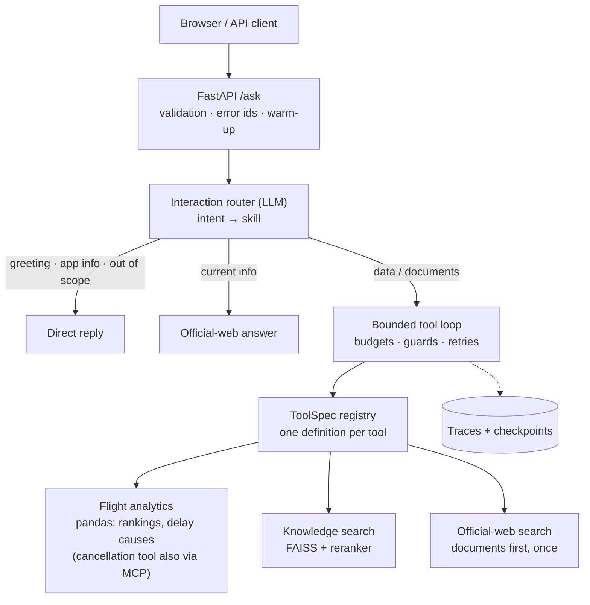

# Agentic Business Intelligence

> A bounded, observable AI agent that answers airline business questions. Deterministic tools calculate, retrieval supplies the evidence, and the LLM decides and explains.

**Use the LLM to decide, orchestrate and explain. Use deterministic tools to calculate. Use retrieval to supply evidence.**

> **Portfolio project.** Independent learning and engineering work, using a limited dataset and selected public documents. Not affiliated with or endorsed by Delta Air Lines.

## What it answers

| Question type | Example | Path |
|---|---|---|
| Flight data | *Which routes from ATL had the worst on-time rate?* · *Why were flights out of ORD delayed?* | Deterministic pandas over July 2026 flight data: rankings by airport, route, carrier or day, and delay-cause breakdowns, shown as **bar charts with a table view**. The model never calculates the numbers. |
| Company documents | *What does the customer service plan say about tarmac delays?* | Local RAG: MiniLM → FAISS → cross-encoder rerank → neighbour context, with page citations |
| Documents + current rules | *Does the contract of carriage still say the same about refunds today?* | Documents first, then **one** official-web search (delta.com, transportation.gov, faa.gov, bts.gov) |
| Current information | *Can I bring my dog in the cabin?* | Official-web search only |
| Greetings / out of scope | *Write me a poem* | Short direct reply; no tools run |

Every answer comes with labelled sources (document page, dataset or URL) and its run details: route, steps, tool calls and run ID.

- **Live progress:** the chat shows each step as it happens ("Searching company documents…", "Analyzing flight data…"), streamed from `POST /ask/stream` as Server-Sent Events.
- **Follow-up questions:** the browser sends the last three exchanges, and a short model call rewrites "and for JFK?" into a standalone question. The answer shows how it was understood.
- **Feedback:** 👍/👎 on each answer is appended to `data/feedback.jsonl` with the run ID, so a rating can be matched to its trace.

## Architecture



- **One definition per tool.** Each tool's schema, validation, retry policy, access policy, budget and prompt text come from one `ToolSpec` in `tools/registry.py`.
- **Small agent stages.** The agent in `core/agent.py` is a short pipeline (`interaction_gate` → `choose_skill` → `run_tool_loop` → `finish_run`).
- **Swappable dependencies.** The OpenAI client, the run store and the tools are passed in as arguments, so tests run on fakes.

More detail: [`docs/ARCHITECTURE.md`](docs/ARCHITECTURE.md).

## Measured results

The results below come from small, frozen development sets. They are not production accuracy estimates.

| Evaluation | Result |
|---|---:|
| Skill routing | 15/15 |
| Interaction routing (incl. web conditions) | 15/15 |
| Tool selection | 15/15 |
| Argument extraction | 7/7 |
| End-to-end agent cases | 8/8 |

Retrieval, on 10 source-verified cases with strict answer-bearing labels:

| Metric | FAISS baseline | + reranking |
|---|---:|---:|
| Hit@1 | 50% | **60%** |
| Hit@3 | 70% | **90%** |
| MRR@5 | 0.600 | **0.750** |
| Expanded-context evidence coverage | — | **10/10** |

There are 170 `pytest` tests, and they make no paid API calls. The on-time metric reproduces the DOT Air Travel Consumer Report for July 2026: 71.7% for the Delta network and 71.9% for Delta mainline.

Methodology: [`docs/EVALUATION.md`](docs/EVALUATION.md).

## Quick start

**Requirements:** Python 3.13+ and [`uv`](https://docs.astral.sh/uv/).

```powershell
uv sync
copy .env.example .env      # then fill in your keys
uv run abi-serve            # http://127.0.0.1:8000  (API docs at /docs)
```

The local embedding and reranker models download on first use, and the server loads them at startup.

| Setting | Required | Purpose |
|---|---|---|
| `OPENAI_API_KEY`, `OPENAI_MODEL` | yes | Every LLM call; the server refuses to start without them |
| `EXA_API_KEY` | for web answers | Official-web search |
| `TOOL_TRANSPORT` | no (`inprocess`) | `mcp` runs the flight tool through the MCP server |
| `PERSIST_RUNS` / `MAX_SAVED_RUNS` | no (`true` / `500`) | Save traces and checkpoints; keep the newest N runs |
| `WARM_UP_ON_STARTUP` | no (`true`) | Load models before serving |

## Tests and evaluations

```powershell
uv run pytest                 # free: fake model clients
uv run ruff check             # lint
uv run abi-eval-routing       # free
uv run abi-eval-retrieval     # free: local models
uv run abi-eval-reranked      # free: local models
uv run abi-eval-interaction   # paid: calls the model
uv run abi-eval-tools         # paid
uv run abi-eval-arguments     # paid
uv run abi-eval-e2e           # paid
uv run abi-eval-analytics     # paid: the flight-analytics tools
```

Rebuild the RAG index after changing documents with `uv run python scripts/build_embedding_cache.py`, then `uv run python scripts/build_faiss_index.py`.

## Project layout

```text
src/agentic_bi/
  api/          FastAPI app, request/response schemas, abi-serve
  config.py     paths, settings, constants: the single source
  core/         agent pipeline, routing, guards, retries, traces, run store
  tools/        ToolSpec registry, flight analysis, knowledge and web search
  rag/          loading, chunking, embeddings, FAISS, reranking
  mcp/          MCP server and client for the flight tool
  evaluation/   eval scripts and shared metrics
  frontend/     chat UI (HTML/CSS/JS, no agent logic)
skills/         per-skill instructions given to the agent
evals/          frozen evaluation cases and retrieval labels
scripts/        index-building scripts
```

## Design decisions

- **Numbers come from code.** Cancellation rates are computed by pandas, never estimated by the model.
- **Retrieval is measured on its own.** Ranked hits and context coverage are reported separately, and neighbour chunks never get fake ranks.
- **Autonomy is bounded in code.** Steps, tool calls, per-tool budgets, repeated calls, documents-before-web ordering and write-action approval are all enforced by the controller, not just requested in the prompt.
- **Evidence is untrusted data.** Retrieved and web content is framed as data, not instructions, and web results are restricted to an allow-list of official domains.
- **Interfaces stay thin.** FastAPI and MCP expose capabilities; the business logic is plain Python.
- **Frozen evaluation before optimisation.** Changes are compared with fixed cases and a recorded baseline.

## Known limitations

- The evaluation sets are small and frozen; the percentages are not production accuracy.
- The flight data is one month (July 2026) of Delta-marketed U.S. domestic flights. Analyses are the fixed metrics and groupings the tools offer, not arbitrary queries.
- The document corpus is four documents (about 700 chunks).
- Checkpoints restore application state, not an interrupted model conversation.
- The main workflow is read-only. A mock write action shows the approval guard.

## Documentation

- [`Architecture`](docs/ARCHITECTURE.md): components, boundaries, execution flow
- [`Evaluation`](docs/EVALUATION.md): datasets, metrics, failure analysis, baseline
- [`Development story`](docs/DEVELOPMENT.md): how the system evolved
- [`Refactor journey`](docs/REFACTOR_JOURNEY.md): the clean-up, step by step
- [`Development log`](docs/DEV_LOG.md): the full engineering log
