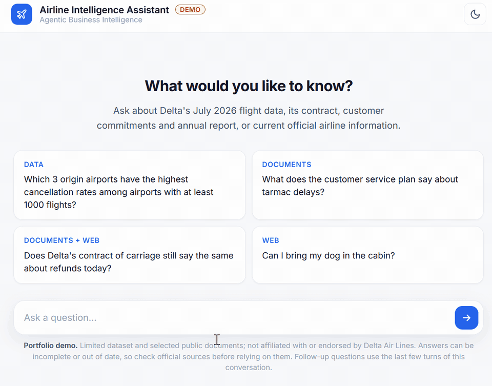
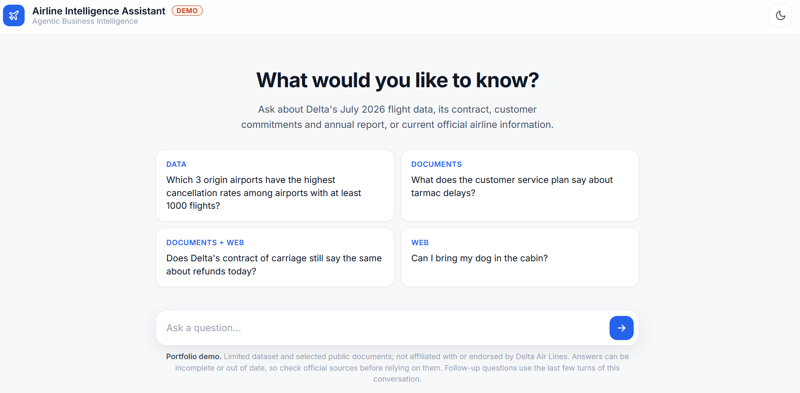
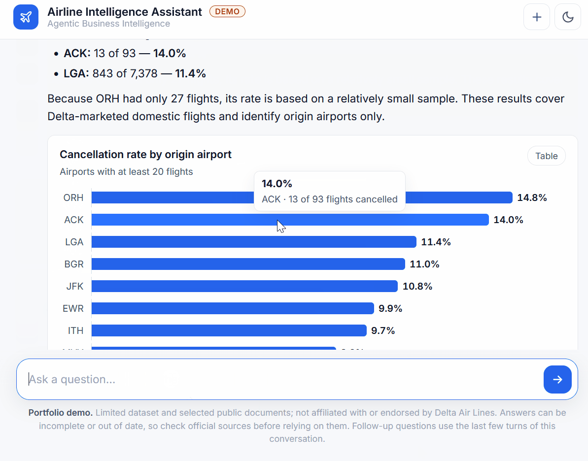
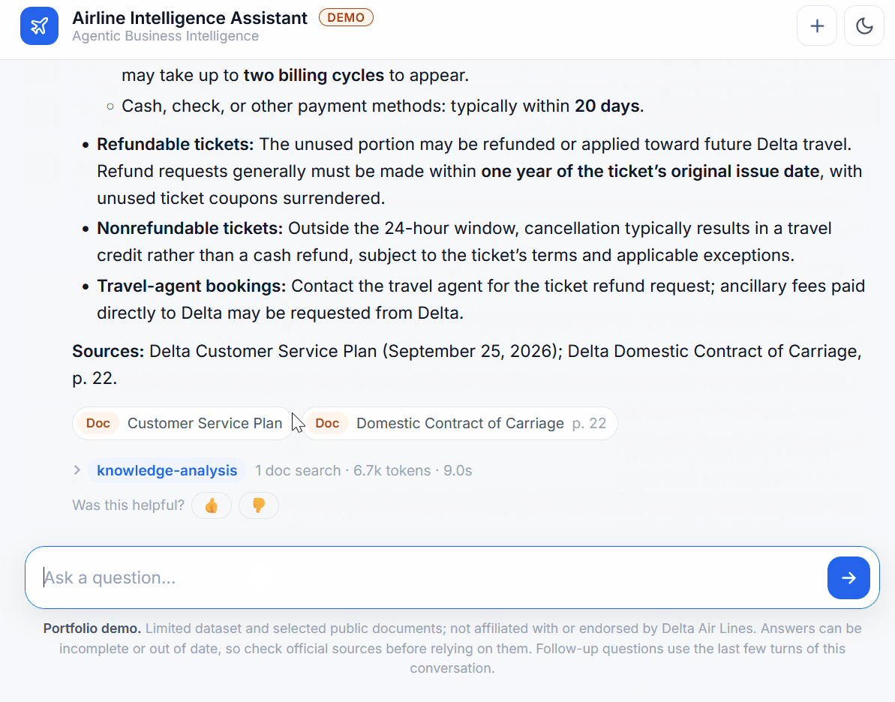
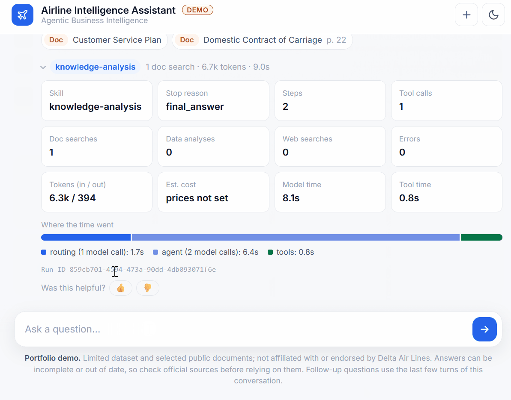
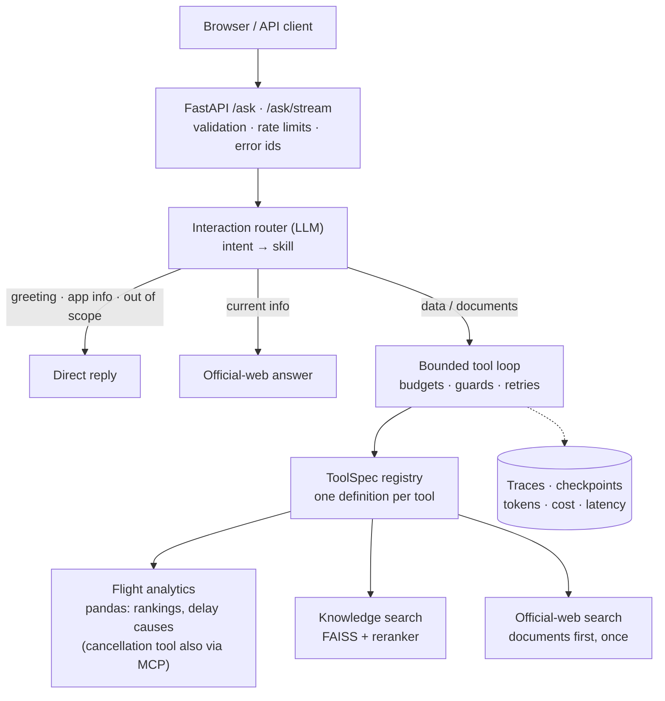

<div align="center">

# Agentic Airline BI

**A bounded, observable AI agent that answers airline business questions:<br/>deterministic tools calculate, retrieval supplies the evidence, and the LLM decides and explains.**

[](https://github.com/norochalise/agentic-airline-bi/actions/workflows/ci.yml)




<sub>▶ <a href="docs/images/demo.mp4">Full walkthrough (MP4, 3½ min)</a></sub>

</div>

> **Portfolio project.** Independent learning and engineering work, using a limited dataset and selected public documents. Not affiliated with or endorsed by Delta Air Lines.

## Highlights

- **Numbers come from code, not the model.** pandas computes every metric. The on-time rate reproduces the DOT Air Travel Consumer Report for July 2026 exactly: **71.7%** for the Delta network.
- **Grounded document answers.** Local RAG (MiniLM → FAISS → cross-encoder rerank → neighbour chunks) with **page-level citations**. Reranking lifts Hit@3 from 70% to **90%**.
- **Autonomy bounded in code.** Step and tool budgets, a repeated-call guard, documents-before-web ordering and write-action approval are enforced by the controller, not just asked for in the prompt.
- **Trusted live answers.** Current-policy questions search only an allow-list of official domains (delta.com, transportation.gov, faa.gov, bts.gov).
- **Observable by default.** Every answer shows its route, sources, **tokens, estimated cost and where the time went**, backed by a full trace and checkpoints.
- **Production habits.** Streaming progress, follow-up questions, rate limits, Docker, CI, frozen evaluation sets and **193 offline tests**.

## Screenshots

<table>
  <tr>
    <td width="50%">
      <picture>
        <source media="(prefers-color-scheme: dark)" srcset="docs/images/home-dark.png">
        
      </picture>
      <p align="center"><b>Start</b>: one example per capability (light and dark themes)</p>
    </td>
    <td width="50%">
      
      <p align="center"><b>Flight data</b>: pandas results as a bar chart, with a table view</p>
    </td>
  </tr>
  <tr>
    <td width="50%">
      
      <p align="center"><b>Documents</b>: answers cite the document and page</p>
    </td>
    <td width="50%">
      
      <p align="center"><b>Run details</b>: tokens, cost and where the time went</p>
    </td>
  </tr>
</table>

## What it answers

| Question type | Example | How it is answered |
|---|---|---|
| Flight data | *Which routes from ATL had the worst on-time rate?* · *Why were flights out of ORD delayed?* | Deterministic pandas over July 2026 flight data: rankings by airport, route, carrier or day, and delay-cause breakdowns, shown as **bar charts with a table view** |
| Company documents | *What does the customer service plan say about tarmac delays?* | Local RAG with reranking and page citations |
| Documents + current rules | *Does the contract of carriage still say the same about refunds today?* | Documents first, then **one** official-web search |
| Current information | *Can I bring my dog in the cabin?* | Official-web search only |
| Greetings / out of scope | *Write me a poem* | Short direct reply; no tools run |

- **Live progress:** each step appears as it happens ("Searching company documents…"), streamed from `POST /ask/stream` as Server-Sent Events.
- **Follow-up questions:** "and for JFK?" is rewritten into a standalone question by a short model call, and the answer shows how it was understood.
- **Feedback:** 👍/👎 on each answer is stored with its run ID, so a rating can be matched to its trace.

## Architecture



- **One definition per tool.** Each tool's schema, validation, retry policy, access policy, budget and prompt text come from one `ToolSpec` in `tools/registry.py`.
- **Small agent stages.** `core/agent.py` is a short pipeline: `interaction_gate` → `choose_skill` → `run_tool_loop` → `finish_run`.
- **Swappable dependencies.** The OpenAI client, the run store and the tools are passed in as arguments, so tests run on fakes.
- **Metered by construction.** One wrapper around the model client records every call's tokens and latency per stage.

More detail: [`docs/ARCHITECTURE.md`](docs/ARCHITECTURE.md).

## Measured results

The results come from small, frozen development sets. They are not production accuracy estimates.

| Evaluation | Result |
|---|---:|
| Skill routing | 15/15 |
| Interaction routing (incl. web conditions) | 15/15 |
| Tool selection | 15/15 |
| Argument extraction | 7/7 |
| End-to-end agent cases | 8/8 |
| Flight analytics | 8/8 |

Retrieval, on 10 source-verified cases with strict answer-bearing labels:

| Metric | FAISS baseline | + reranking |
|---|---:|---:|
| Hit@1 | 50% | **60%** |
| Hit@3 | 70% | **90%** |
| MRR@5 | 0.600 | **0.750** |
| Expanded-context evidence coverage | — | **10/10** |

The 193 `pytest` tests make no paid API calls. Methodology: [`docs/EVALUATION.md`](docs/EVALUATION.md).

## Tech stack

| Layer | Technology |
|---|---|
| Reasoning | OpenAI Responses API (function calling, `previous_response_id` chaining, structured outputs) |
| Retrieval | sentence-transformers MiniLM embeddings, FAISS, MS MARCO cross-encoder reranker, PyMuPDF |
| Data | pandas over the BTS on-time dataset (July 2026, Delta-marketed domestic flights) |
| Live web | Exa search, restricted to official domains |
| API | FastAPI, Pydantic, Server-Sent Events, MCP server for the flight tool |
| Frontend | Plain HTML, CSS and JavaScript (no framework, no agent logic) |
| Tooling | uv, ruff, pytest, Docker (CPU-only PyTorch), GitHub Actions |

## Quick start

**Requirements:** Python 3.13+ and [`uv`](https://docs.astral.sh/uv/), plus an OpenAI API key (and an Exa key for web answers).

```powershell
git clone https://github.com/norochalise/agentic-airline-bi.git
cd agentic-airline-bi
uv sync
copy .env.example .env      # then fill in your keys
uv run abi-serve            # http://127.0.0.1:8000  (API docs at /docs)
```

The local embedding and reranker models download on first use, and the server loads them at startup.

**Or with Docker** (no local Python needed):

```powershell
copy .env.example .env      # fill in your keys
docker compose up --build   # http://localhost:8000
```

- **Models are baked in:** the container starts without downloading anything.
- **Run data is kept:** run logs and feedback live in named volumes that survive rebuilds.
- **Small, unprivileged image:** CPU-only PyTorch, running as a non-root user.

**Continuous integration:** `.github/workflows/ci.yml` runs ruff, the full test suite (no API keys needed) and a Docker build on every push and pull request.

## Configuration

| Setting | Required | Purpose |
|---|---|---|
| `OPENAI_API_KEY`, `OPENAI_MODEL` | yes | Every LLM call; the server refuses to start without them |
| `EXA_API_KEY` | for web answers | Official-web search |
| `TOOL_TRANSPORT` | no (`inprocess`) | `mcp` runs the flight tool through the MCP server |
| `PERSIST_RUNS` / `MAX_SAVED_RUNS` | no (`true` / `500`) | Save traces and checkpoints; keep the newest N runs |
| `WARM_UP_ON_STARTUP` | no (`true`) | Load models before serving |
| `ASK_RATE_LIMIT` | no (`10`) | Questions per minute per client; `0` turns it off |
| `ASK_DAILY_LIMIT` | no (`0`, off) | Questions per day across all clients; caps API spend on a public demo |
| `OPENAI_INPUT_PRICE_PER_M` / `OPENAI_OUTPUT_PRICE_PER_M` | no | USD per million tokens for your model; enables the cost estimate (`OPENAI_CACHED_INPUT_PRICE_PER_M` optional) |

Behind a hosting proxy, also set `FORWARDED_ALLOW_IPS=*` so uvicorn trusts `X-Forwarded-For` and the rate limit applies per visitor rather than to the proxy.

## Tests and evaluations

```powershell
uv run pytest                 # free: fake model clients
uv run ruff check             # lint
uv run abi-eval-routing       # free
uv run abi-eval-retrieval     # free: local models
uv run abi-eval-reranked      # free: local models
uv run abi-eval-interaction   # paid: calls the model
uv run abi-eval-tools         # paid
uv run abi-eval-arguments     # paid
uv run abi-eval-e2e           # paid
uv run abi-eval-analytics     # paid: the flight-analytics tools
```

After changing the documents, rebuild the RAG index with `uv run python scripts/build_embedding_cache.py`, then `uv run python scripts/build_faiss_index.py`.

## Project layout

```text
src/agentic_bi/
  api/          FastAPI app, schemas, rate limits, charts, abi-serve
  config.py     paths, settings, constants: the single source
  core/         agent pipeline, routing, guards, retries, usage metering, traces
  tools/        ToolSpec registry, flight analysis, knowledge and web search
  rag/          loading, chunking, embeddings, FAISS, reranking
  mcp/          MCP server and client for the flight tool
  evaluation/   eval scripts and shared metrics
  frontend/     chat UI (HTML/CSS/JS, no agent logic)
skills/         per-skill instructions given to the agent
evals/          frozen evaluation cases and retrieval labels
scripts/        index-building scripts
docs/           architecture, evaluation, development story, images
```

## Design decisions

- **Numbers come from code.** Metrics are computed by pandas, never estimated by the model.
- **Retrieval is measured on its own.** Ranked hits and context coverage are reported separately, and neighbour chunks never get fake ranks.
- **Autonomy is bounded in code.** Every limit is enforced by the controller, not just requested in the prompt.
- **Evidence is untrusted data.** Retrieved and web content is framed as data, not instructions, and web results come only from an allow-list of official domains.
- **Interfaces stay thin.** FastAPI and MCP expose capabilities; the business logic is plain Python.
- **Frozen evaluation before optimisation.** Changes are compared with fixed cases and a recorded baseline.

## Known limitations

- The evaluation sets are small and frozen; the percentages are not production accuracy.
- The flight data covers one month (July 2026) of Delta-marketed U.S. domestic flights. Analyses are the fixed metrics and groupings the tools offer, not arbitrary queries.
- The document corpus is four documents (about 700 chunks).
- Checkpoints restore application state, not an interrupted model conversation.
- The main workflow is read-only. A mock write action shows the approval guard.
- Rate limits are kept in memory, so they assume a single server instance. Cost estimates rely on the prices you configure.

## Roadmap

- **Trace viewer:** a page per run showing the route, each tool call with its arguments and output, the guards that fired and the time spent.
- **Flexible flight queries:** one structured query tool (whitelisted group-by, metric and filters) so many more data questions work, while pandas still calculates.
- **Answer cache:** reuse answers to identical questions to cut demo cost.
- **Broader evidence:** more months of flight data with trend charts, and larger held-out evaluation sets.

## Documentation

- [Architecture](docs/ARCHITECTURE.md): components, boundaries, execution flow
- [Evaluation](docs/EVALUATION.md): datasets, metrics, failure analysis, baseline
- [Development story](docs/DEVELOPMENT.md): how the system evolved
- [Refactor journey](docs/REFACTOR_JOURNEY.md): the clean-up, step by step
- [Development log](docs/DEV_LOG.md): the full engineering log

## License

[MIT](LICENSE) © 2026 Noro Chalise
