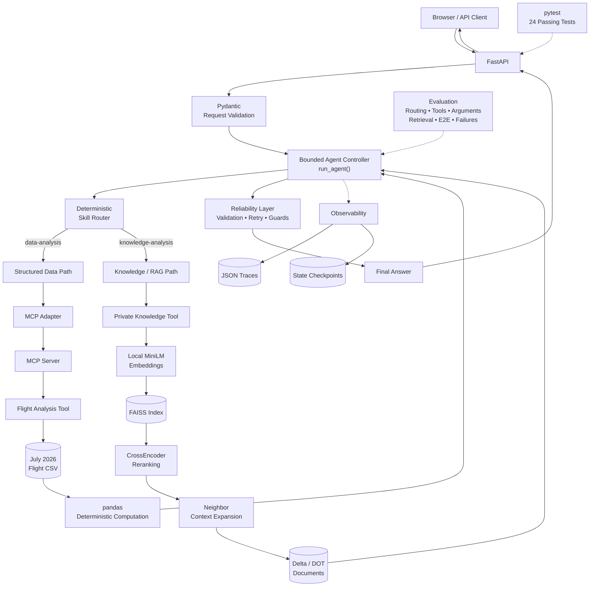

# Agentic Business Intelligence

> A production-minded AI engineering project that combines **deterministic business-data analysis** with **grounded private-document reasoning** inside a bounded, observable agent architecture.

Agentic Business Intelligence is an end-to-end portfolio project built around a simple engineering principle:

**Use the LLM to decide, orchestrate, and explain. Use deterministic tools to calculate. Use retrieval systems to supply evidence.**

The system answers two different kinds of airline business questions through one agent:

- **Structured analysis** over Delta-marketed U.S. domestic flight data using pandas through MCP.
- **Private knowledge analysis** over Delta and U.S. DOT documents using local embeddings, FAISS, CrossEncoder reranking, and source-aware RAG.

Around those capabilities, the project adds typed tool contracts, bounded execution, selective retries, approval guards, evaluation, failure analysis, observability, checkpointing, FastAPI, a browser interface, and automated regression testing.

> **Portfolio project:** This repository is an independent learning and engineering project. It is not affiliated with or endorsed by Delta Air Lines.

---

## What the System Does

### Structured business question

> Which 5 origin airports had the highest cancellation rates among airports with at least 500 flights?

The system routes the question to the **data-analysis** path:

```text
Question
   ↓
Skill Router
   ↓
Agent Controller
   ↓
Typed Tool Call
   ↓
MCP Client / Server
   ↓
pandas
   ↓
Validated Result
   ↓
LLM Explanation
```

The model does **not** calculate cancellation rates from raw flight rows. Python performs the deterministic computation.

### Private-document question

> According to Delta's Contract of Carriage, what refund is due when an unused ticket qualifies for an involuntary refund?

The system routes the question to the **knowledge-analysis** path:

```text
Question
   ↓
Skill Router
   ↓
Agent Controller
   ↓
Private Knowledge Tool
   ↓
MiniLM Embedding
   ↓
FAISS Candidate Retrieval
   ↓
CrossEncoder Reranking
   ↓
Neighbor Context Expansion
   ↓
Source/Page Evidence
   ↓
Grounded Answer
```

This separation is deliberate: structured calculations and evidence retrieval require different reliability strategies.

---

## Architecture



The architecture intentionally keeps the interfaces thin. FastAPI exposes the agent as a service; MCP exposes a capability. Neither layer owns the underlying business logic.

For the detailed system design, see [`docs/ARCHITECTURE.md`](docs/ARCHITECTURE.md).

---

## Engineering Highlights

| Area | Implementation |
|---|---|
| Agent orchestration | Bounded controller with explicit termination |
| Skill routing | Deterministic keyword/phrase router |
| Structured analysis | pandas over local flight data |
| Tool protocol | Typed MCP client/server boundary |
| Private knowledge | Local RAG over Delta/DOT documents |
| Embeddings | `sentence-transformers/all-MiniLM-L6-v2` |
| Vector search | FAISS |
| Reranking | `cross-encoder/ms-marco-MiniLM-L6-v2` |
| Context recovery | Neighbor-chunk expansion |
| Validation | Pydantic input/output contracts |
| Reliability | Error classification + selective bounded retry |
| Safety | Tool budgets, repeat guards, approval boundary |
| Observability | Structured JSON execution traces |
| Recovery | Application-state checkpoints |
| Service layer | FastAPI |
| User interface | HTML/CSS/JavaScript web interface |
| Software testing | 24 passing pytest tests |
| AI evaluation | Routing, tools, arguments, retrieval, E2E, failures |

---

## Why This Is More Than an LLM Wrapper

The project deliberately avoids giving the model responsibility for everything.

### Deterministic work stays deterministic

Cancellation rates are calculated by Python/pandas rather than estimated or derived by the model.

### Retrieval is measured independently

A fluent answer is not treated as proof of good retrieval. Retrieval quality is evaluated against source-verified evidence cases.

### Autonomy is bounded

Agent steps, tool calls, retries, repeated calls, and consequential actions have explicit limits or policies.

### State is inspectable

The controller records execution state, tool history, observations, errors, stop reasons, traces, and checkpoints.

### Interfaces remain replaceable

FastAPI and MCP expose capabilities without absorbing the core business logic.

### AI behavior and software behavior are tested differently

```text
pytest
→ deterministic software contracts

Evaluation suites
→ model, retrieval, and agent behavior
```

---

## Measured Results

All AI/retrieval percentages below apply **only to the project's frozen development/evaluation sets**. They are not estimates of universal production accuracy.

### Agent behavior

| Evaluation | Result |
|---|---:|
| Skill routing | **15/15 (100%)** |
| Tool selection | **15/15 (100%)** |
| Structured argument extraction | **7/7 (100%)** |
| End-to-end agent cases | **8/8 (100%)** |
| Classified failures after final M16 fixes | **0 on the frozen 8-case set** |

### Retrieval

The frozen M14 retrieval set contains 10 source-verified cases.

| Metric | Baseline | Reranked |
|---|---:|---:|
| Hit@1 | 50% | **60%** |
| Hit@3 | 70% | **90%** |
| Hit@5 | 70% | **90%** |
| MRR@5 | 0.600 | **0.750** |
| Expanded-context evidence coverage | — | **10/10 (100%)** |

Neighbor-expanded context is measured separately from ranked retrieval. Adjacent chunks are **not assigned artificial retrieval ranks**.

### Software regression

```text
24 passed
```

The deterministic suite covers API behavior, frontend serving, routing, schemas, reliability, action guards, checkpointing, and observability.

For methodology and limitations, see [`docs/EVALUATION.md`](docs/EVALUATION.md).

---

## Evaluation-Driven Engineering

One of the most important results in this project was a **failure**, not a successful demo.

An end-to-end evaluation asked the system to determine fuel expense as a percentage of operating expense from Delta's 2025 10-K.

The knowledge tool executed, but the final answer failed.

Investigation produced this chain:

```text
End-to-End Evaluation Failure
            ↓
Tool Invocation Was Successful
            ↓
Failure Analysis
            ↓
Inspect Production Retrieval
            ↓
Production Registry Still Used Baseline Retriever
            ↓
Integrate Improved Retriever
            ↓
New Schema Contract Failure
            ↓
CrossEncoder Raw Score Was Not Bounded
            ↓
Keep Reranking Score Internal
Expose Compatible External Score
            ↓
Run Full Regression
            ↓
8/8 End-to-End + 0 Classified Failures
```

This changed the project architecture.

The lesson was important:

> **A successful tool call does not guarantee a successful agent outcome.**

Correct routing, tool selection, retrieval, interface contracts, context construction, and final synthesis all matter.

See [`docs/DEVELOPMENT.md`](docs/DEVELOPMENT.md) for the full engineering progression.

---

## RAG Pipeline

The private corpus intentionally remains small enough for local experimentation:

- Delta 2025 Form 10-K
- Delta Domestic Contract of Carriage
- Delta Customer Service Plan
- one 2026 U.S. DOT Air Travel Consumer Report

Ingestion produced approximately **700 chunks** while preserving source and page metadata.

The improved retrieval pipeline is:

```text
Question
   ↓
all-MiniLM-L6-v2
   ↓
FAISS
   ↓
Top 15 Candidates
   ↓
CrossEncoder Reranking
   ↓
Top 5 Ranked Evidence
   ↓
Neighbor Expansion
   ↓
Source/Page-Aware Context
   ↓
Grounded Answer
```

Dense retrieval provides efficient candidate generation. CrossEncoder reranking improves evidence ordering, while neighbor expansion addresses evidence split across chunk boundaries.

---

## Reliability and Safety

The system treats reliability as part of agent architecture rather than generic exception handling.

### Typed validation

Pydantic validates structured tool arguments and outputs.

### Selective retry

Retry behavior distinguishes transient failures from permanent and business-rule errors.

Retryable operations use bounded attempts and backoff rather than unlimited retry loops.

### Execution guards

The controller includes explicit limits for:

- maximum agent steps;
- maximum tool calls;
- repeated identical calls;
- knowledge searches;
- structured-data analyses;
- invalid tool inputs.

### Consequential-action boundary

The primary Delta BI workflow is read-only.

A separate protected-action layer demonstrates how write capabilities can require explicit approval before execution. The project also demonstrates duplicate/idempotency protection for mock consequential actions.

No real Delta write system is connected.

---

## Observability and Checkpointing

Agent runs can emit structured events such as:

```text
agent_started
skill_selected
tool_started
tool_completed
checkpoint_saved
agent_finished
```

Traces contain information such as:

- unique run ID;
- UTC timestamps;
- selected skill;
- tool execution status;
- tool duration;
- step/tool counts;
- stop reason;
- error information.

State checkpoints are persisted after successful tool observations and at final termination.

> **Scope:** checkpoint restoration reconstructs application state. It is not full durable crash-resume of an interrupted external model conversation.

---

## Web Interface

The project includes a lightweight browser interface served directly by FastAPI.

The frontend intentionally contains **no agent logic**:

```text
HTML / CSS / JavaScript
          ↓
      POST /ask
          ↓
       FastAPI
          ↓
      run_agent()
          ↓
 Agent + Tools + RAG
          ↓
   Structured Response
          ↓
 Browser Presentation
```

Along with the answer, the interface exposes execution metadata:

- selected skill;
- stop reason;
- step count;
- tool-call count;
- knowledge-search count;
- data-analysis count;
- error count;
- run ID.

This makes the agent trajectory visible instead of presenting only chatbot text.

---

## Repository Structure

```text
agentic-business-intelligence/
├── src/
│   └── agentic_bi/
│       ├── api/
│       │   ├── app.py
│       │   └── schemas.py
│       ├── core/
│       │   ├── action_guard.py
│       │   ├── agent.py
│       │   ├── checkpoint.py
│       │   ├── observability.py
│       │   ├── prompts.py
│       │   ├── reliability.py
│       │   ├── schemas.py
│       │   └── state.py
│       ├── data/
│       │   └── loader.py
│       ├── evaluation/
│       ├── frontend/
│       │   ├── index.html
│       │   ├── styles.css
│       │   └── app.js
│       ├── mcp/
│       │   ├── server.py
│       │   └── tools.py
│       ├── rag/
│       ├── skills/
│       └── tools/
├── scripts/
│   ├── build_embedding_cache.py
│   └── build_faiss_index.py
├── evals/
├── docs/
└── tests/
```

---

## Quick Start

### Requirements

- Python 3.13+
- `uv`
- an OpenAI API key for model-backed agent runs

Clone the repository and install the locked environment:

```powershell
uv sync
```

Create `.env` in the project root:

```text
OPENAI_API_KEY=your_key_here
OPENAI_MODEL=your_model_name_here
```

Do not commit `.env`.

The local embedding and reranking models are downloaded on first use.

### Start the application

```powershell
uv run uvicorn agentic_bi.api.app:app --reload
```

Open:

```text
http://127.0.0.1:8000/
```

The interactive API documentation remains available at:

```text
http://127.0.0.1:8000/docs
```

Health check:

```text
GET /health
```

Agent API:

```text
POST /ask
```

Example request:

```json
{
  "question": "Which 5 origin airports have the highest cancellation rates among airports with at least 500 flights?"
}
```

---

## Example Questions

### Structured analysis

```text
Which 5 origin airports have the highest cancellation rates among airports with at least 500 flights?
```

```text
Using the flight data, show the top 4 origin airports by cancellation rate with at least 700 flights.
```

### Private knowledge

```text
According to Delta's Contract of Carriage, what refund is due when an unused ticket qualifies for an involuntary refund?
```

```text
What does Delta's Customer Service Plan say about notifying passengers of known delays, cancellations, and diversions?
```

```text
According to Delta's 2025 10-K, what percentage of operating expense was fuel in 2025, 2024, and 2023?
```

---

## Run Tests

```powershell
uv run pytest
```

Current regression status:

```text
24 passed
```

FastAPI tests mock `run_agent()` so normal software regression does not consume model API credits or launch the complete RAG/MCP execution path.

---

## Run Evaluations

```powershell
uv run python -m agentic_bi.evaluation.routing_eval
uv run python -m agentic_bi.evaluation.tool_selection_eval
uv run python -m agentic_bi.evaluation.argument_eval
uv run python -m agentic_bi.evaluation.retrieval_eval
uv run python -m agentic_bi.evaluation.agent_end_to_end_eval
```

Some evaluation paths invoke the real model and may consume API credits.

---

## Key Design Decisions

### LLM for orchestration, Python for computation

The model decides which capability is appropriate and explains results. Deterministic calculations remain in deterministic code.

### Local embeddings

Local MiniLM embeddings reduce recurring API cost and are appropriate for the project's approximately 700-chunk corpus.

### FAISS at the current scale

A local vector index keeps the system reproducible without introducing hosted infrastructure that the current corpus does not require.

### Two-stage retrieval

FAISS provides fast candidate generation; CrossEncoder reranking improves final evidence ordering.

### Context expansion without metric inflation

Neighbor chunks can improve answer context, but they are not treated as independently ranked retrieval hits.

### Deterministic routing where sufficient

With two current skills, an inspectable keyword/phrase router avoids an unnecessary model call.

### Thin MCP and API boundaries

Protocols expose capabilities while business logic remains ordinary reusable Python.

### Frozen evaluation before optimization

Retrieval and agent changes are compared against fixed cases rather than changing the benchmark after each failure.

### Explicit autonomy limits

Agent steps, tool calls, retries, and consequential actions are bounded in code.

---

## Known Limitations

This project demonstrates production-minded engineering patterns, but it is not presented as a production airline platform.

- Evaluation datasets are intentionally small frozen development sets.
- Reported percentages are not production accuracy estimates.
- The structured dataset is a limited July 2026 Delta-marketed U.S. domestic-flight sample.
- The private-document corpus is deliberately small.
- FAISS is appropriate for the current local scale, not distributed retrieval infrastructure.
- The current structured BI surface focuses primarily on origin cancellation analysis rather than arbitrary natural-language analytics over every CSV field.
- Checkpointing restores application state, not an interrupted external model conversation.
- The primary workflow is read-only; consequential-write protection is demonstrated separately.
- Model-backed behavior can vary with model/version/configuration.
- The repository is not affiliated with or endorsed by Delta Air Lines.

---

## Future Work

Reasonable extensions include:

- additional deterministic business-analysis tools;
- larger held-out evaluation datasets;
- citation correctness and completeness evaluation;
- groundedness/faithfulness measurement;
- retrieval metadata filtering and hybrid search experiments;
- token, latency, and cost regression thresholds;
- more durable workflow semantics if true crash recovery becomes necessary;
- extracting the domain-independent architecture into a reusable agentic BI package.

The goal is not to add technology for its own sake. Each extension should address a measurable limitation or concrete use case.

---

## Documentation

For deeper technical detail:

- [`Architecture`](docs/ARCHITECTURE.md) — components, boundaries, and execution flow
- [`Evaluation`](docs/EVALUATION.md) — datasets, metrics, failure analysis, and limitations
- [`Development Story`](docs/DEVELOPMENT.md) — how the system evolved from a plain API call into the current architecture

---

## Engineering Takeaways

1. **An LLM with tools is not automatically a reliable agent.** State, orchestration, limits, validation, feedback, and evaluation matter.
2. **Deterministic business questions deserve deterministic computation.**
3. **RAG quality is a pipeline problem, not an embedding-model problem.**
4. **Correct-document retrieval can still miss answer-bearing evidence.**
5. **Reranking and context construction solve different retrieval problems.**
6. **A successful tool call does not guarantee a correct system outcome.**
7. **Evaluation should drive architecture changes.**
8. **AI evaluation and deterministic software testing answer different questions.**
9. **MCP exposes capabilities; it does not replace business logic.**
10. **Production-minded engineering means knowing what the system does not guarantee.**

---

Built as a focused exercise in **designing, implementing, debugging, evaluating, and explaining an agentic AI system for real business-information workflows**.