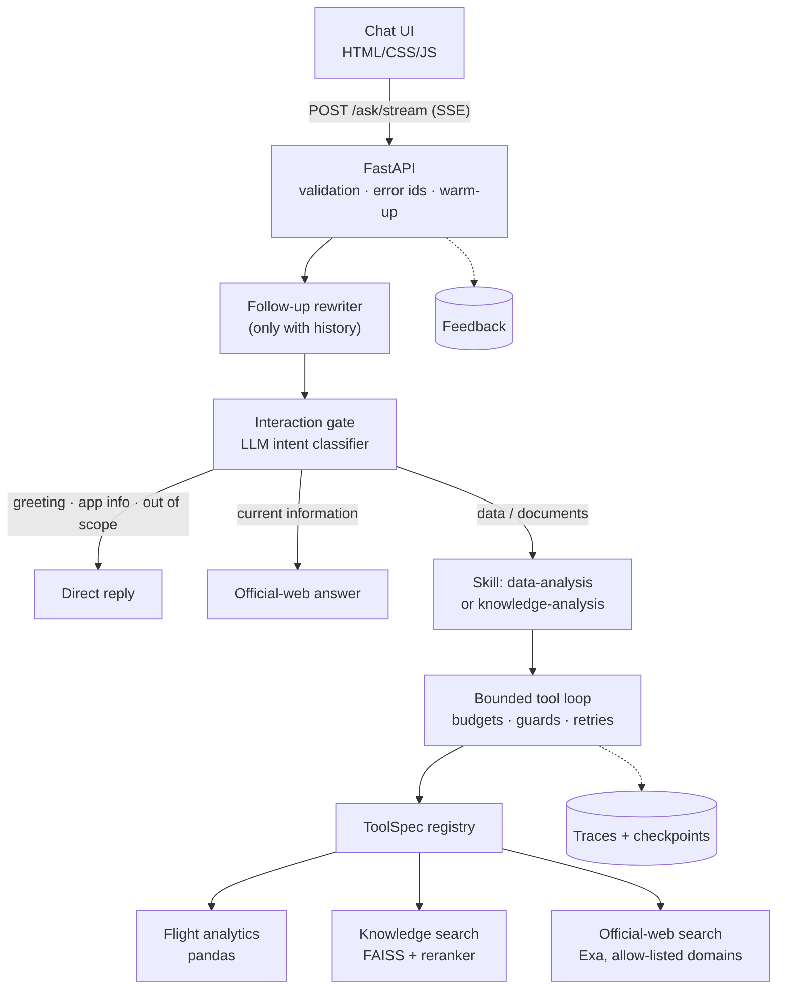

# Architecture

How the Airline Intelligence Assistant is put together, and why. To see it running, look at the demo and screenshots in the [README](../README.md#screenshots).

The design follows one rule:

> **The LLM decides, orchestrates and explains. Deterministic code calculates. Retrieval supplies evidence.**

Contents:
1. [System overview](#1-system-overview)
2. [Request lifecycle](#2-request-lifecycle)
3. [Interaction gate](#3-interaction-gate)
4. [Skills](#4-skills)
5. [The bounded tool loop](#5-the-bounded-tool-loop)
6. [Tool registry](#6-tool-registry)
7. [Data path](#7-data-path)
8. [Knowledge path (RAG)](#8-knowledge-path-rag)
9. [Official-web path](#9-official-web-path)
10. [Reliability and safety](#10-reliability-and-safety)
11. [Observability and persistence](#11-observability-and-persistence)
12. [API](#12-api)
13. [Frontend](#13-frontend)
14. [Configuration](#14-configuration)
15. [Packaging and CI](#15-packaging-and-ci)
16. [Design decisions](#16-design-decisions)
17. [Boundaries](#17-boundaries)

---

## 1. System overview



| Package | Responsibility |
|---|---|
| `api/` | FastAPI app, request and response schemas, SSE progress, chart specs, `abi-serve` |
| `core/` | Agent pipeline, interaction routing, follow-ups, prompts, schemas, guards, retries, traces, run store |
| `tools/` | `ToolSpec` registry and tool implementations: flight analytics, knowledge search, web search |
| `rag/` | Loading, chunking, embeddings, FAISS, reranking |
| `mcp/` | MCP server and client for the cancellation tool |
| `skills/` | Keyword fallback router and skill loader (instructions live in `skills/<name>/SKILL.md`) |
| `evaluation/` | Eval scripts and shared metrics |
| `frontend/` | Chat UI, with no agent logic |
| `config.py` | Every path, setting and constant |

---

## 2. Request lifecycle

`run_agent()` in `core/agent.py` is a short pipeline:

```text
[condense_question]  follow-up -> standalone question (only with history)
interaction_gate     classify; answer early exits directly
choose_skill         intent -> skill (keyword router as fallback)
run_tool_loop        model <-> tools under budgets and guards
finish_run           final checkpoint, trace, AgentResult
```

```python
run_agent(
    question,
    verbose=False,
    *,
    client=None,     # OpenAI client; defaults to one shared instance
    store=None,      # RunStore; defaults to disk (or memory if PERSIST_RUNS=false)
    tools=None,      # ToolSpec mapping; defaults to the registry
    history=None,    # earlier turns, for follow-ups
    on_event=None,   # live progress listener (used by /ask/stream)
) -> AgentResult
```

Every collaborator is injected, so the tests run the real pipeline with fake clients and tools and make no paid calls.

**Follow-ups.** When `history` is present, `core/followup.py` makes one model call that rewrites, for example, "and for JFK?" into a self-contained question. The conversation is framed as untrusted data, and an empty or runaway rewrite falls back to the user's words. Everything downstream (routing, tools, evals) sees only the standalone question.

---

## 3. Interaction gate

`core/interaction.py` asks the model to classify the question with a strict JSON schema into one of six intents:

| Intent | Handling |
|---|---|
| `conversation`, `app_info`, `out_of_scope` | Fixed reply from `core/interaction_response.py`; no tools |
| `current_airline_info` | `tools/delta_current_info.py` searches official sites and writes a grounded answer; no tool loop |
| `airline_data` | → `data-analysis` skill |
| `airline_knowledge` | → `knowledge-analysis` skill |

The router prompt lists exactly what the local documents and dataset cover. A question whose topic is outside them, such as bag fees or pet travel, or one that asks for current or live information, goes to the official-web path rather than being answered from memory.

---

## 4. Skills

A skill is a set of instructions added to the agent's system prompt: `skills/data-analysis/SKILL.md` or `skills/knowledge-analysis/SKILL.md`. It also decides which tools are offered.

The skill normally comes from the intent (`INTENT_TO_SKILL`). The deterministic keyword router in `skills/router.py` is only a fallback for unmapped intents. It uses whole-word matching from `core/text_match.py`, so "rate" never matches "corporate".

---

## 5. The bounded tool loop

```text
model call (instructions + offered tools)
   │
   ├─ no function calls ─────────────► final answer
   │
   └─ function calls ─► handle_tool_call (guards)
                           └─ execute_tool: access policy → retry → output validation
                       ─► tool outputs back to the model
                       ─► budget spent? next call has no tools → forced final answer
```

**Guards in `handle_tool_call`:**

| Guard | Effect |
|---|---|
| `MAX_STEPS` (4), `MAX_TOOL_CALLS` (4) | Stop the run |
| Tool not offered to this skill | Stop (`blocked_unknown_tool`) |
| Invalid JSON or arguments | Error returned to the model so it can correct itself |
| Repeated identical call | Stop (`repeated_tool_call`) |
| Web search before any private search | Error returned to the model (`web_before_private_search`) |
| Per-tool budget (`max_calls_per_run`) | Stop (`<tool>_budget_exceeded`) |

When a tool listed in `FINAL_ANSWER_TRIGGERS` reaches its budget, the next model call carries no tools and the model must answer. Stop reasons, trace event names and `error_type` values are stable, because the tests and evals assert them.

---

## 6. Tool registry

`tools/registry.py` defines each tool once, as a `ToolSpec`:

```python
@dataclass(frozen=True)
class ToolSpec:
    name: str
    description: str
    func: Callable[..., dict]
    input_model: type[BaseModel]      # validates arguments; generates the model-facing JSON schema
    output_model: type[BaseModel]     # validates results
    prompt_summary: str = ""          # capability line in the system prompt
    category: Literal["knowledge", "data", "web", "action"] = "data"
    access: Literal["read", "write"] = "read"
    requires_approval: bool = False
    max_attempts: int = 1
    max_calls_per_run: int | None = None
    skills: frozenset[str | None] | None = None   # None = every skill
    offered_to_model: bool = True
```

Everything else is **generated** from the spec:
- the OpenAI strict-mode tool JSON
- the prompt's capability list (only the tools offered to the skill)
- the access policy used by `core/action_guard.py`
- the per-run counters reported in `AgentResult`

When the registry replaced seven hand-maintained tables, the generated tool JSON and prompts were verified **byte-identical** to the originals before any paid evaluation.

| Tool | Category | Offered to | Budget |
|---|---|---|---|
| `search_private_knowledge` | knowledge | all skills | 2 |
| `analyze_top_origin_cancellation_rates` | data | all skills | 1 |
| `rank_flight_performance` | data | data-analysis | 2 |
| `analyze_delay_causes` | data | data-analysis | 2 |
| `search_official_web` | web | knowledge-analysis | 1 |
| `issue_customer_credit` (mock write) | action | never offered | — |

The pydantic `Field(description=...)` text in `core/schemas.py` is what the model reads, so editing it changes behaviour.

---

## 7. Data path

The dataset holds 149,051 Delta-marketed U.S. domestic flights from July 2026, across 211 airports and four operating carriers: DL, OO, 9E and YX. It is loaded once per process and cached.

| Tool | What it computes |
|---|---|
| `analyze_top_origin_cancellation_rates` | Origin airports ranked by cancellation rate, above a volume floor |
| `rank_flight_performance` | Group by origin, destination, route, operating carrier, date or weekday; rank by cancellation rate, on-time arrival rate, average arrival/departure delay, diversion rate or flight count; filter by airport; compare named groups (`only`); calendar order for time groupings |
| `analyze_delay_causes` | Delay minutes by cause (carrier, weather, NAS, security, late aircraft) and cancellations by reason code, optionally for one airport or carrier |

**Metric definitions** follow the DOT Air Travel Consumer Report:
- **On time:** a flight is on time when it is completed and arrives less than 15 minutes late. Cancelled and diverted flights count as *not* on time. This reproduces the report's July 2026 figures exactly: 71.7% for the Delta network and 71.9% for DL mainline. A test pins both.
- **Average delay:** uses completed flights; early arrivals count as 0.
- **Delay causes:** cover only flights at least 15 minutes late.

**Transport.** The cancellation tool runs in-process by default, in 0.02 s. `TOOL_TRANSPORT=mcp` routes it through the MCP server in `mcp/` instead, as one subprocess per call taking about 2.3 s. That keeps the MCP integration demonstrable without making every request pay for it.

**Charts.** `api/charts.py` turns each successful data-tool result into a chart spec (title, unit, labelled rows) without recomputing anything. The UI draws it.

---

## 8. Knowledge path (RAG)

**Corpus:**
- the Delta 2025 Form 10-K
- the Domestic Contract of Carriage (plain language, August 2026)
- the Customer Service Plan
- the DOT Air Travel Consumer Report (September 2026, covering July data)

**Offline indexing** is done by `scripts/build_embedding_cache.py`, then `scripts/build_faiss_index.py`:

```text
load (PDF per page, TXT whole) → chunk (180 words, 30 overlap) → embed (MiniLM, normalized)
→ FAISS inner-product index      →  data/processed/rag/  (700 chunks × 384 dims)
```

Chunk IDs are `<file-stem>:p<page>:c<n>` for PDFs and `<file-stem>:c<n>` for text files. Stored paths are project-relative.

**Query time** (`run_knowledge_search`):

```text
question → MiniLM embedding → FAISS top 15 → cross-encoder rerank → top 5
         → add previous/next chunk from the same document → context for the model
```

Each result carries:
- `retrieval_type`: `reranked`, `neighbor_previous` or `neighbor_next`
- the FAISS `score`
- the cross-encoder `rerank_score`

Neighbour chunks get `score=None`, never a fabricated rank, so the model can tell primary evidence from surrounding context.

---

## 9. Official-web path

`tools/delta_official_web.py` searches with Exa. Results come only from an allow-list (`ALLOWED_DOMAINS`): delta.com, transportation.gov, faa.gov and bts.gov, including their subdomains. Any other URL is dropped, even if the search provider returns it.

It is reached in two ways:
- **directly,** for `current_airline_info` questions;
- **as a fallback** inside `knowledge-analysis`: one web search, allowed only after a private search, when the documents don't cover the question or the user asks whether a document is still current.

Web content is framed as untrusted data. When web and document evidence disagree, the answer reports both.

---

## 10. Reliability and safety

- **Validation on both sides:** pydantic validates tool arguments and tool results.
- **Error taxonomy** (`core/reliability.py`): `TransientToolError` and `ToolTimeoutError` are retried with exponential backoff, up to the spec's `max_attempts`. Business-rule, validation and permanent errors fail immediately. The MCP client classifies only connection and timeout failures as transient.
- **Write actions:** every call passes `enforce_action_policy`. A `write` tool that `requires_approval` raises `ApprovalRequiredError` unless approved. The mock credit action also blocks duplicates with an idempotency key. No real write system is connected.
- **Prompt-injection hygiene:** retrieved, web and conversation content is labelled as data, not instructions. UI labels from tool output are inserted with `textContent`.

---

## 11. Observability and persistence

Every run produces a structured trace (`core/observability.py`) with a run ID, timestamps, tool durations and events such as:
- `agent_started`, `question_rewritten`, `interaction_classified`, `skill_selected`
- `tool_started` / `tool_completed`, `guard_triggered`
- `checkpoint_saved`, `agent_finished`

**Usage and latency.** `run_agent` wraps the OpenAI client in a `MeteredClient` (`core/usage.py`), so every `responses.create` call is timed and its token usage recorded, with no change to the call sites. Calls are grouped by stage (`follow-up`, `routing`, `web answer`, `agent`). `finish_run` adds tool time from the `tool_completed` events (and, for official-web answers, the search time recorded on `current_airline_info_retrieved`) and stores the summary on `AgentTrace.usage` and `AgentResult.usage`: tokens in, cached and out, model calls, model, tool and total seconds, and an estimated cost when `OPENAI_INPUT_PRICE_PER_M` and `OPENAI_OUTPUT_PRICE_PER_M` are set. Prices are settings because they change and the model is configurable. Exa searches are counted, not priced.

Application-state checkpoints are saved after each successful tool observation and at the end. `restore_agent_state` rebuilds `AgentState`. This restores application state; it is not durable resumption of an interrupted model conversation.

Storage goes through a `RunStore` (`core/run_store.py`):
- `FileRunStore` writes to `data/traces/` and `data/checkpoints/`. It keeps the newest `MAX_SAVED_RUNS` (default 500) and never prunes the run being saved.
- `MemoryRunStore` is used by tests and when `PERSIST_RUNS=false`.

---

## 12. API

| Endpoint | Purpose |
|---|---|
| `GET /` and `/static/*` | Chat UI, served with `Cache-Control: no-cache` |
| `GET /health` | Liveness |
| `POST /ask` | Run the agent and return `AskResponse` |
| `POST /ask/stream` | The same work as Server-Sent Events: `progress` events, then one `result` or `error` |
| `POST /feedback` | Append `{run_id, rating, comment}` to `data/feedback/feedback.jsonl` |

`AskRequest` caps questions at 2,000 characters and history at 6 messages. `AskResponse` returns:
- the answer and the question as understood
- the route and stop reason
- counters for steps, tool calls, searches and analyses
- labelled sources and chart specs
- `usage`: tokens, estimated cost and the time per stage (the UI draws it as a "where the time went" bar)

**Failures.** `/ask` and `/ask/stream` share `_answer()`. A failure returns `{detail, error_id}`: 503 for missing configuration, 500 otherwise. The traceback is logged under the same ID and never sent to the client.

**Startup.** The lifespan hook refuses to start without `OPENAI_API_KEY` and `OPENAI_MODEL`, and warns if `EXA_API_KEY` is missing. It then loads the FAISS index, embedding model, reranker and flight data (about 13 s cold), so the first user doesn't wait.

**Rate limits.** Every question costs model calls, so `/ask` and `/ask/stream` check two in-memory sliding windows (`api/rate_limit.py`) after the request validates: `ASK_RATE_LIMIT` per client per minute and an optional `ASK_DAILY_LIMIT` across everyone. Over a limit, the endpoint returns 429 with `{detail}` and `Retry-After` before any agent work or stream starts. The state lives in one process, which suits a single-instance demo.

**Streaming.** `/ask/stream` runs the agent in a worker thread. The agent's `on_event` listener feeds a queue that becomes SSE, and `api/progress.py` maps trace events to plain-language status lines.

---

## 13. Frontend

Plain HTML, CSS and JavaScript served by FastAPI. There is no build step and no agent logic.

- **Chat thread:**
  - suggestion cards and a light/dark theme
  - a "Demo" badge and disclaimer
  - grouped sources and collapsible run details
  - 👍/👎 feedback
- **Live progress:** the stream is read with `fetch` plus a stream reader, because `EventSource` can't POST.
- **Follow-ups:** the last three exchanges are sent as history, and "Answered as: …" appears when a question was rewritten.
- **Charts:** single-series horizontal bars.
  - Bars start from a zero baseline, with the value at each bar's tip.
  - Each bar shows a tooltip on hover and keyboard focus.
  - A table toggle shows the same values.
  - The accent colour was validated for contrast and colour-blindness against both theme surfaces.
- **Hardening:** the pinned CDN scripts (marked, DOMPurify) carry SRI hashes, and rendered Markdown is sanitized.

---

## 14. Configuration

`config.py` is the only place that:
- resolves the project root and derives paths
- loads `.env`
- holds constants: models, `RETRIEVAL_CANDIDATE_K=15`, `RETRIEVAL_TOP_K=5` and the agent limits

Settings are read **at call time** through functions such as `openai_model()`, `exa_api_key()`, `tool_transport()` and `persist_runs()`. A missing value raises `ConfigError` naming the variable.

| Setting | Default |
|---|---|
| `OPENAI_API_KEY`, `OPENAI_MODEL` | required |
| `EXA_API_KEY` | needed for web answers |
| `TOOL_TRANSPORT` | `inprocess` (or `mcp`) |
| `PERSIST_RUNS`, `MAX_SAVED_RUNS` | `true`, `500` |
| `WARM_UP_ON_STARTUP` | `true` |
| `ASK_RATE_LIMIT` | `10` per client per minute (`0` = off) |
| `OPENAI_INPUT_PRICE_PER_M`, `OPENAI_OUTPUT_PRICE_PER_M`, `OPENAI_CACHED_INPUT_PRICE_PER_M` | unset (cost not shown); USD per million tokens |
| `ASK_DAILY_LIMIT` | `0` (no cap); questions per day across all clients |

---

## 15. Packaging and CI

- **Python packaging:** `uv`, with a locked environment. Console scripts are `abi-serve` and `abi-eval-*`.
- **CPU-only torch on Linux:** torch comes from PyTorch's CPU index on Linux (`[tool.uv.sources]`), which keeps several GB of CUDA libraries out of the image and CI.
- **Docker:** `python:3.13-slim`, with the models and data baked in and `HF_HUB_OFFLINE=1` at runtime. It runs as a non-root user with a health check. `docker-compose.yml` reads `.env` and keeps traces, checkpoints and feedback in volumes.
- **CI** (`.github/workflows/ci.yml`): `uv sync --frozen`, ruff lint and format check, and pytest with coverage. The tests use fake model clients, so no secrets are needed. CI then builds the Docker image.

---

## 16. Design decisions

| Decision | Why |
|---|---|
| pandas for metrics | Exact, reproducible numbers; the model explains them and never computes them |
| Local embeddings + FAISS | No per-query embedding cost; right-sized for 700 chunks; reproducible |
| Two-stage retrieval | FAISS finds candidates cheaply; the cross-encoder orders the evidence |
| Neighbour expansion, measured separately | Recovers evidence split across chunks without inflating ranked metrics |
| LLM interaction router, keyword fallback | Intent needs understanding; the cheap, deterministic router still covers unmapped cases |
| One `ToolSpec` per tool | One edit per tool change; generated schemas can't drift from the code |
| Rewrite follow-ups, don't thread history | Every downstream component and eval keeps working on one self-contained question |
| MCP opt-in | Shows the protocol boundary without charging every request a subprocess |
| Thin API and frontend | Business logic stays in plain, testable Python |

---

## 17. Boundaries

- One month of flight data. Analyses are the fixed metrics and groupings the tools offer, not arbitrary queries.
- Four documents. FAISS fits this scale; it is not distributed retrieval.
- Evaluation sets are small and frozen; results are not production accuracy.
- Checkpoints restore application state, not an interrupted model conversation.
- The main workflow is read-only; the write path is a mock that demonstrates the guard.
- Rate limits live in one process's memory; several instances would need a shared store such as Redis.
- Not affiliated with or endorsed by Delta Air Lines.
