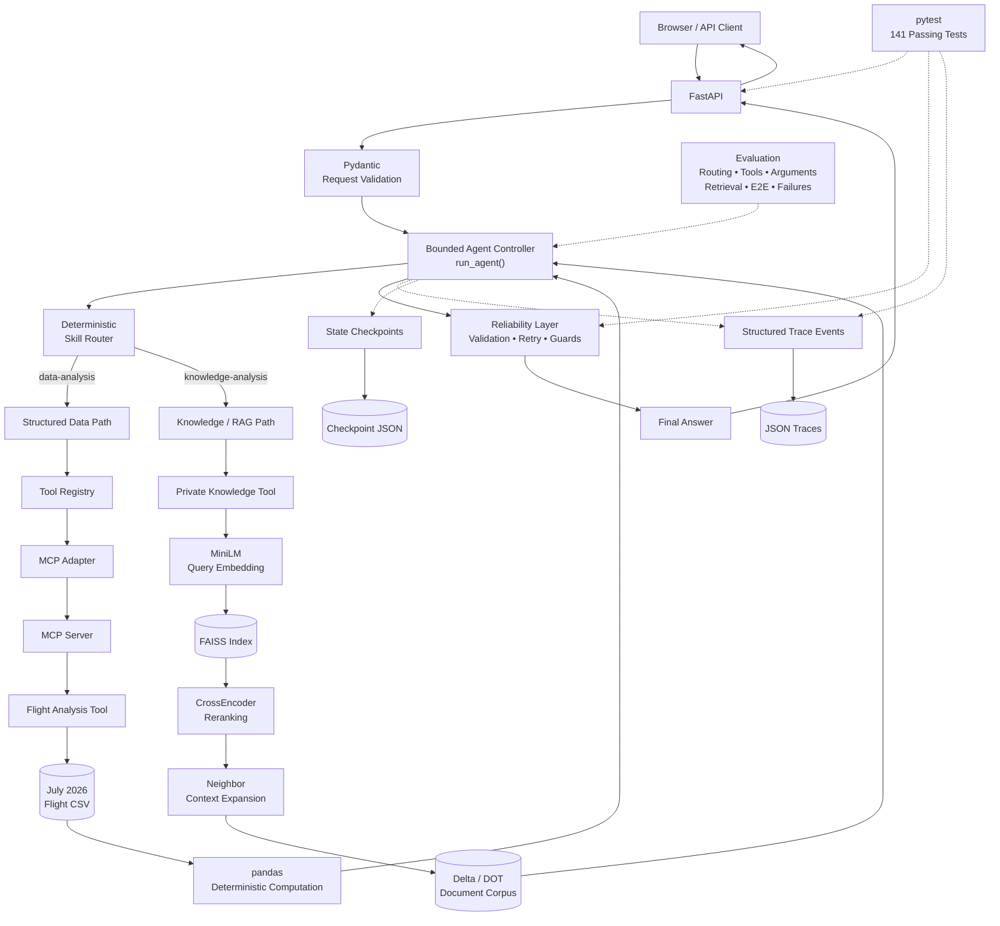
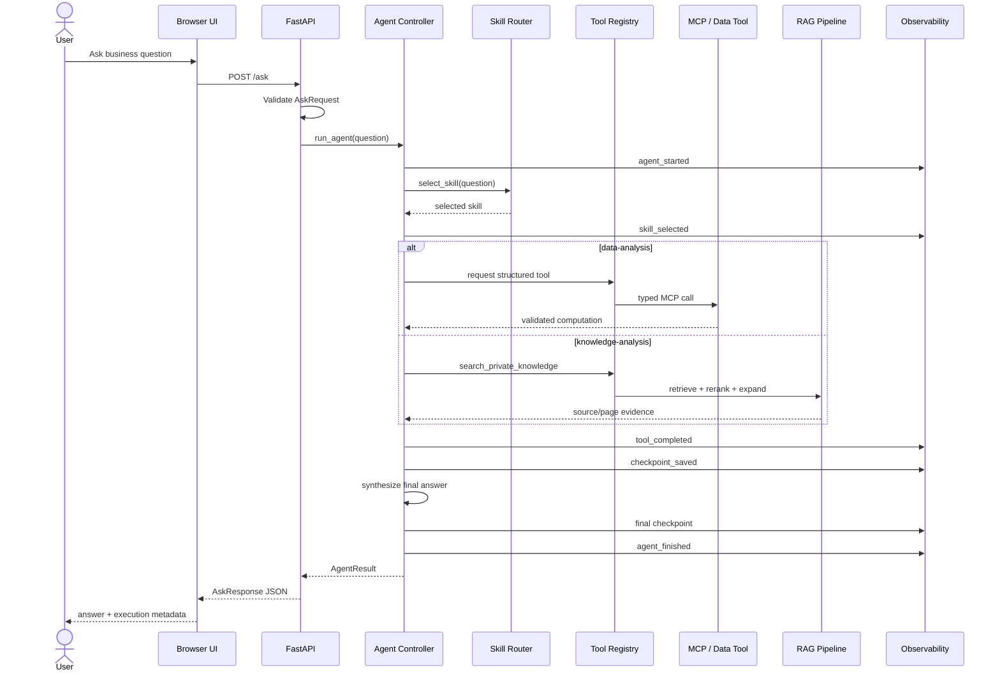
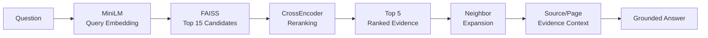

# Architecture

> **October 2026 update.** The sections below describe the design as first built. The October 2026 refactor kept the behaviour (same evals, and byte-identical tool schemas and prompts) but changed the structure:
>
> - **Routing:** an LLM interaction router runs first and maps the intent to a skill. The keyword router (§9) is now only a fallback. Greetings, app questions, out-of-scope requests and current-information questions are answered before the tool loop.
> - **Tool registry (§10):** one `ToolSpec` per tool replaces the separate `TOOLS`, `FUNCTIONS`, schema, policy and access tables. The OpenAI tool JSON and the prompt's capability list are generated from it, and `action_guard` reads it.
> - **Agent controller (§7):** `run_agent` is a pipeline: `interaction_gate` → `choose_skill` → `run_tool_loop` → `finish_run`. Each call goes through `handle_tool_call` (guards) and `execute_tool` (access policy → retry → output validation). The client, run store and tools are injected.
> - **Data path (§11–12):** the flight tool runs in-process by default (about 0.02 s instead of about 2.3 s). MCP is opt-in with `TOOL_TRANSPORT=mcp`.
> - **Web path:** a third tool, `search_official_web`, is offered only to knowledge-analysis, once, after a private search.
> - **Knowledge results (§14):** each result carries `retrieval_type` and `rerank_score`; neighbour chunks have `score=None`.
> - **Configuration:** `config.py` holds every path, setting and constant.
> - **Persistence (§19):** run storage goes through `core/run_store.py` (keeps the newest `MAX_SAVED_RUNS`).
> - **API (§6):** `/ask` returns `{detail, error_id}` on failure, caps questions at 2,000 characters, and the server loads models at startup.
>
> See [`REFACTOR_JOURNEY.md`](REFACTOR_JOURNEY.md) for the step-by-step changes.

## 1. Overview

Agentic Business Intelligence is designed around one principle:

> **Use the LLM for orchestration and language reasoning while delegating deterministic computation and evidence retrieval to specialized tools.**

The system supports two primary workloads:

1. **Structured business-data analysis** over Delta-marketed U.S. domestic flight data.
2. **Grounded private-document analysis** over a small Delta/DOT document corpus.

Both paths are coordinated by the same bounded agent controller and share validation, reliability, safety, observability, checkpointing, and evaluation infrastructure.

The architecture intentionally separates:

```text
reasoning
computation
retrieval
protocols
interfaces
state
reliability
evaluation
presentation
```

rather than placing all responsibilities inside one model prompt.

---

## 2. System Architecture



The system has one orchestration layer but two fundamentally different evidence/computation paths.

That distinction is deliberate.

---

## 3. Request Lifecycle

A browser request and a direct API request eventually enter the same agent.



The frontend never bypasses the API or calls tools directly.

---

# 4. Architectural Layers

The project can be understood as a set of cooperating layers:

```text
Presentation
    ↓
Service Interface
    ↓
Agent Orchestration
    ↓
Skill Routing
    ↓
Tool Registry
    ↓
Capability Execution
    ↓
Data / Knowledge Sources
```

Cross-cutting concerns operate around those layers:

```text
Validation
Reliability
Safety
State
Observability
Checkpointing
Evaluation
Testing
```

This separation is important because each concern answers a different engineering question.

---

# 5. Presentation Layer

## `frontend/`

The browser interface consists of:

```text
frontend/
├── index.html
├── styles.css
└── app.js
```

It is intentionally lightweight and contains no agent intelligence.

Its responsibility is:

```text
collect question
      ↓
POST /ask
      ↓
receive structured response
      ↓
display answer
      ↓
display execution metadata
```

The interface exposes:

```text
selected skill
stop reason
step count
tool-call count
knowledge-search count
data-analysis count
error count
run ID
```

This makes the agent execution visible rather than presenting only a chatbot answer.

The frontend uses `textContent` when presenting generated answer text instead of inserting model output as raw HTML.

---

# 6. API Layer

## `api/app.py`

FastAPI acts as a thin service boundary over the reusable agent.

Current endpoints:

```text
GET  /
GET  /health
POST /ask
```

Static frontend assets are mounted under:

```text
/static
```

The application serves:

```text
/
→ frontend/index.html

/static/styles.css
→ frontend stylesheet

/static/app.js
→ frontend JavaScript
```

The `/ask` flow is:

```text
AskRequest
    ↓
run_agent()
    ↓
AgentResult
    ↓
AskResponse
```

The API does not duplicate:

- skill routing;
- MCP logic;
- RAG logic;
- retry behavior;
- business calculations;
- agent orchestration.

This keeps the agent independently reusable from Python.

## `api/schemas.py`

The API uses Pydantic contracts for request and response validation.

An empty question is rejected before agent execution.

The response exposes both the final answer and execution metadata.

---

# 7. Agent Controller

## `core/agent.py`

The main reusable orchestration entry point is:

```python
run_agent(
    question: str,
    verbose: bool = False,
) -> AgentResult
```

`AgentResult` exposes the completed run:

```text
goal
selected_skill
final_answer
stop_reason
step_count
tool_call_count
knowledge_search_count
data_analysis_count
tool_history
observations
errors
trace
```

The controller is responsible for:

1. initializing state;
2. creating an execution trace;
3. selecting a skill;
4. entering the bounded agent loop;
5. accepting model tool requests;
6. validating tool arguments;
7. enforcing execution guards;
8. executing the registered tool;
9. validating structured output;
10. recording observations;
11. saving checkpoints;
12. continuing or terminating;
13. synthesizing the final answer;
14. persisting final execution information.

The controller coordinates capabilities rather than implementing business calculations itself.

---

# 8. Explicit Agent State

## `core/state.py`

`AgentState` records runtime progress.

Representative state:

```text
goal
step_count
tool_call_count
selected_skill
stop_reason
tool_history
observations
errors
```

Making state explicit provides several benefits:

```text
bounded execution
debugging
observability
checkpointing
evaluation
failure analysis
```

Without explicit state, these concerns would have to be reconstructed indirectly from model messages or console output.

---

# 9. Skill Routing

## `skills/router.py`

The current system supports two skills:

```text
data-analysis
knowledge-analysis
```

Routing is deterministic.

Keyword and phrase scoring determines whether a question concerns structured flight data or the private-document corpus.

The router can return:

```text
data-analysis
knowledge-analysis
None
```

rather than forcing every question into an inappropriate skill.

### Why not another model call?

There are currently only two routing targets.

A deterministic router is:

- cheaper;
- inspectable;
- reproducible;
- easy to evaluate;
- sufficient for the current routing space.

Model-based routing can be introduced later if the number or ambiguity of skills makes deterministic routing inadequate.

---

# 10. Tool Registry

## `tools/registry.py`

The registry centralizes the connection between model-visible tool definitions and executable Python capabilities.

It contains structures such as:

```text
TOOLS
FUNCTIONS
INPUT_SCHEMAS
OUTPUT_SCHEMAS
TOOL_POLICIES
```

Conceptually:

```text
Model
   ↓
Tool Schema
   ↓
Registry
   ↓
Validated Arguments
   ↓
Python Capability
   ↓
Validated Result
```

This prevents the controller from accumulating hard-coded knowledge about every capability.

---

# 11. Structured Data Path

The structured path handles quantitative questions over flight data.

Current primary capability:

```python
analyze_top_origin_cancellation_rates(
    min_flights: int,
    top_n: int,
)
```

The underlying dataset contains Delta-marketed U.S. domestic flights for July 2026.

Relevant fields include:

```text
FlightDate
Origin
Dest
DepDelayMinutes
ArrDelayMinutes
Cancelled
CancellationCode
Diverted
CarrierDelay
WeatherDelay
NASDelay
SecurityDelay
LateAircraftDelay
Distance
```

The analysis function:

1. loads the local CSV;
2. groups flights by origin;
3. counts total flights;
4. counts cancellations;
5. applies the requested minimum-flight threshold;
6. calculates cancellation rates;
7. sorts results;
8. returns the requested top N;
9. validates the structured output.

The model does not perform these calculations from raw rows.

That is a deliberate reliability boundary:

> **Deterministic business questions should use deterministic computation.**

---

# 12. MCP Capability Boundary

The structured flight-analysis capability is exposed through MCP.

Current package:

```text
mcp/
├── server.py
└── tools.py
```

The architecture is:

```text
pandas business function
          ↓
      MCP server
          ↓
    MCP client/adapter
          ↓
      tool registry
          ↓
         agent
```

The MCP server exposes the capability with typed inputs and structured output.

The adapter lets the synchronous agent consume the MCP capability without moving business logic into the protocol layer.

### Architectural role of MCP

MCP provides a standardized capability boundary.

It does **not** replace:

- the pandas calculation;
- Pydantic validation;
- agent orchestration;
- business rules.

The business function remains independently understandable and testable Python.

---

# 13. Private Knowledge / RAG Path

The second major path handles questions that require evidence from private documents.

## Corpus

The current corpus contains:

- Delta 2025 Form 10-K;
- Delta Domestic Contract of Carriage;
- Delta Customer Service Plan;
- one 2026 U.S. DOT Air Travel Consumer Report.

Document ingestion produced approximately:

```text
700 chunks
```

with source and page metadata preserved.

---

# 14. Retrieval Pipeline

The improved knowledge path uses multiple retrieval stages.



## Embedding model

```text
sentence-transformers/all-MiniLM-L6-v2
```

Embeddings are generated locally.

## Vector search

FAISS performs efficient dense candidate retrieval.

## Reranker

```text
cross-encoder/ms-marco-MiniLM-L6-v2
```

The CrossEncoder evaluates query-document pairs more deeply than the initial vector similarity stage.

## Neighbor expansion

Adjacent chunks can be added after reranking when evidence crosses chunk boundaries.

The architecture therefore distinguishes:

```text
reranked_results
```

from:

```text
context_results
```

This distinction is important both technically and for evaluation.

Neighbor chunks can improve final context without pretending they occupied ranked retrieval positions.

---

# 15. Validation Boundary

Pydantic is used at several system boundaries.

## API validation

```text
external request
      ↓
AskRequest
```

## Tool argument validation

```text
model-generated arguments
          ↓
typed input schema
```

## Tool result validation

```text
Python capability result
          ↓
typed output schema
```

Validation helps prevent malformed data from silently crossing architectural boundaries.

It also makes tool contracts explicit.

---

# 16. Reliability Layer

## `core/reliability.py`

The reliability layer distinguishes between different failure types.

Representative categories include:

```text
TransientToolError
ToolTimeoutError
BusinessRuleError
PermanentToolError
```

`execute_with_retry()` provides bounded retry with backoff.

Retry policy is selective.

For example:

```text
temporary connectivity problem
→ potentially retry

timeout
→ potentially retry

invalid business input
→ do not blindly retry

permanent failure
→ do not blindly retry
```

Tool-specific policies determine the allowed number of attempts.

The project intentionally avoids the pattern:

```text
catch every exception
→ retry everything
```

because retries are only useful when another attempt can plausibly change the outcome.

---

# 17. Execution Guards

The bounded controller includes explicit execution limits.

Examples include:

```text
maximum steps
maximum tool calls
repeat-call protection
knowledge-search limits
data-analysis limits
invalid-input handling
explicit stop reasons
```

These controls prevent the agent loop from operating indefinitely or repeatedly issuing identical work.

Autonomy is therefore constrained by code rather than only by prompt instructions.

---

# 18. Read / Write Safety Boundary

The primary Agentic BI workflow is read-only.

The project separately demonstrates how consequential capabilities can be protected.

## `core/action_guard.py`

The action guard maintains tool access policies and enforces approval requirements before protected execution.

Conceptually:

```text
Agent requests action
        ↓
Lookup access policy
        ↓
Read action?
   ├── yes → execute
   └── no
        ↓
Write action?
        ↓
Explicit approval present?
   ├── no  → block
   └── yes → execute
```

The policy check occurs before the underlying function is executed.

The project also demonstrates duplicate/idempotency protection for a mock consequential action.

No real Delta write system is connected.

The purpose is to demonstrate the architectural boundary required before an agent is allowed to perform consequential actions.

---

# 19. Observability

## `core/observability.py`

Agent execution is represented by structured events rather than relying only on terminal output.

Representative trace:

```text
agent_started
skill_selected
tool_started
tool_completed
checkpoint_saved
agent_finished
```

Trace information includes:

```text
run ID
question
UTC timestamps
event payloads
tool duration
stop reason
total duration
```

Traces are serialized as JSON.

This makes a completed run inspectable after execution.

---

# 20. Checkpointing

## `core/checkpoint.py`

Checkpoints serialize `AgentState`.

Current checkpoints are created:

- after successful tool observations;
- at final termination.

A stored checkpoint can be loaded and converted back into application state.

Conceptually:

```text
AgentState
    ↓
checkpoint_to_dict()
    ↓
JSON
    ↓
load_checkpoint()
    ↓
restore_agent_state()
    ↓
AgentState
```

## Scope boundary

Checkpointing currently provides:

> **application-state restoration**

It does not provide:

> complete durable replay/resume of an interrupted external model conversation.

The system does not persist all external model-conversation state required to resume an interrupted response at the exact point of failure.

A durable workflow engine would be a separate architectural capability.

---

# 21. Agent Result Boundary

Completed execution is returned through `AgentResult`.

This prevents FastAPI, tests, or future clients from needing direct access to internal mutable state.

The API converts:

```text
AgentResult
```

into:

```text
AskResponse
```

The response currently exposes:

```text
answer
selected_skill
stop_reason
run_id
step_count
tool_call_count
knowledge_search_count
data_analysis_count
error_count
```

This creates a stable interface between orchestration and external clients.

---

# 22. Evaluation Architecture

AI-system behavior is evaluated separately from ordinary software testing.

The evaluation stack contains:

```text
Routing Evaluation
Tool Selection Evaluation
Argument Evaluation
Retrieval Evaluation
End-to-End Agent Evaluation
Failure Analysis
```

Conceptually:


This loop was used during development rather than relying only on successful manual demos.

One important example was the 10-K fuel-expense case, where failure analysis revealed that the production registry still used baseline retrieval after an improved retriever had been developed.

The resulting fix changed the production retrieval architecture.

---

# 23. Software Testing Boundary

pytest covers deterministic software contracts.

Current regression status (October 2026):

```text
141 passed
```

Coverage includes areas such as:

```text
skill routing
API schemas
API behavior
frontend serving
reliability / retry
action guards
checkpointing
observability
```

API tests mock `run_agent()`.

This keeps routine regression:

- fast;
- deterministic;
- inexpensive;
- independent of model availability.

The distinction is intentional:

```text
pytest
→ Did a software contract break?

AI evaluation
→ Is model/retrieval/agent behavior still correct on the frozen cases?
```

Neither layer replaces the other.

---

# 24. Failure-Driven Architecture

A central design principle of the project is:

> **Failures should produce architectural information.**

The strongest example occurred during end-to-end evaluation:

```text
Knowledge Question
       ↓
Correct Skill
       ↓
Correct Tool
       ↓
Tool Executes
       ↓
Final Answer Fails
```

The initial trajectory looked healthy.

Failure analysis showed:

```text
experimental improved retrieval existed
              ↓
production registry still used baseline retrieval
```

After integrating improved retrieval, a second problem appeared:

```text
CrossEncoder raw score
        ↓
external schema expected bounded score
        ↓
validation failure
```

The final architecture therefore keeps reranking logits internal while exposing a compatible bounded score through the external tool contract.

This example demonstrates why agent architecture cannot be judged solely from whether a tool was called successfully.

---

# 25. Repository Architecture

The current package is organized by responsibility.

```text
src/
└── agentic_bi/
    ├── api/
    │   ├── app.py
    │   └── schemas.py
    │
    ├── core/
    │   ├── action_guard.py
    │   ├── agent.py
    │   ├── checkpoint.py
    │   ├── observability.py
    │   ├── prompts.py
    │   ├── reliability.py
    │   ├── schemas.py
    │   └── state.py
    │
    ├── data/
    │   └── loader.py
    │
    ├── evaluation/
    │
    ├── frontend/
    │   ├── index.html
    │   ├── styles.css
    │   └── app.js
    │
    ├── mcp/
    │   ├── server.py
    │   └── tools.py
    │
    ├── rag/
    │
    ├── skills/
    │
    └── tools/

scripts/
├── build_embedding_cache.py
└── build_faiss_index.py

evals/
docs/
tests/
```

Experimental demo scripts used during learning were removed from the final production package.

Offline index-building utilities were moved into `scripts/`.

This keeps the installable package focused on runtime capabilities.

---

# 26. Design Principles

## 1. Separate reasoning from computation

The model decides and explains.

Python calculates deterministic metrics.

Retrieval infrastructure supplies evidence.

---

## 2. Make state explicit

Explicit state enables:

```text
limits
debugging
evaluation
observability
checkpointing
```

---

## 3. Keep interfaces thin

FastAPI exposes the application.

MCP exposes a capability.

Neither should become the location of business logic.

---

## 4. Validate boundaries

Model-generated arguments, capability outputs, and external requests should cross typed contracts where practical.

---

## 5. Bound autonomy

Steps, tool calls, retries, repeated calls, and consequential actions have explicit controls.

---

## 6. Evaluate components independently

A correct route does not guarantee a correct tool.

A correct tool does not guarantee good retrieval.

Good retrieval does not guarantee a correct final answer.

Each layer needs appropriate evaluation.

---

## 7. Freeze evaluation before optimization

Before/after comparisons are meaningful only when the cases remain stable.

---

## 8. Do not inflate metrics

Neighbor-expanded context improves evidence availability but is not treated as ranked retrieval.

---

## 9. Use failures as engineering evidence

Failures are classified and investigated rather than hidden behind successful demonstrations.

---

## 10. Add infrastructure only when justified

The project uses local embeddings and FAISS because they are appropriate for the current scale.

Distributed infrastructure would add complexity without solving a current requirement.

---

# 27. Current Scope vs. Production Platform

The project demonstrates production-minded engineering patterns.

It does **not** claim to be a production airline platform.

The current scope does not include:

- enterprise authentication or RBAC;
- distributed task queues/workers;
- production sandboxing;
- horizontally distributed vector infrastructure;
- broad arbitrary BI query synthesis;
- real airline write actions;
- sophisticated multi-agent orchestration;
- large held-out evaluation datasets;
- production monitoring-platform integration;
- durable workflow-engine semantics;
- full external model-conversation crash recovery.

These are architectural extensions that should be introduced when a concrete requirement justifies them.

---

# 28. Architectural Summary

The complete system can be reduced to one principle:

```text
User Question
      ↓
Understand the Work
      ↓
Choose the Correct Capability
      ↓
Execute Through a Controlled Boundary
      ↓
Validate the Result
      ↓
Record What Happened
      ↓
Return a Grounded Answer
      ↓
Evaluate Whether the System Behaved Correctly
```

The architecture is therefore not centered on the LLM alone.

It is centered on the interaction between:

```text
model
tools
state
retrieval
deterministic computation
validation
reliability
safety
observability
evaluation
interfaces
```

That combination turns a model call into an inspectable, bounded, and testable agentic business-information system.