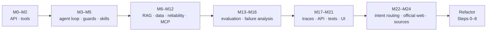

# Development Story

How the project grew from one model call into a bounded, evaluated agent, and what each stage taught.

For the cleanup that followed, see [`REFACTOR_JOURNEY.md`](REFACTOR_JOURNEY.md). The original, unedited engineering log is archived in [`DEV_LOG.md`](DEV_LOG.md).

---

## Goal

The goal was to go from understanding individual AI concepts to being able to **design, build, debug, evaluate, refactor, test, ship and explain** a complete agentic system.

Delta Air Lines made a good working domain because one business setting offers two kinds of information:
- **structured flight-performance data**, where answers must be computed;
- **policy, service, regulatory and financial documents**, where answers must be found and cited.

That raised the central design question: *how should one agent handle questions that need fundamentally different kinds of work?* The answer became the architecture: structured questions go to deterministic computation, knowledge questions go to grounded retrieval, and the LLM coordinates.

---

## Timeline

| When | Milestones |
|---|---|
| Sep 25, 2026 | M0–M12: model calls, tools, the agent loop, RAG, the data agent, reliability, MCP |
| Sep 26 | Modular architecture; M13–M14 agent and retrieval evaluation |
| Sep 27 | M15–M21: end-to-end eval, failure analysis, observability, FastAPI, pytest, docs, web UI; M22–M24: interaction routing, official-web search, answer sources |
| Oct 2 | The refactor, Steps 0–8: repair, cleanup, new analytics, conversation UX, Docker and CI |

---

## M0–M2: one call, then tools

**M0** sent a single question to the model and inspected the response: no tools, loop or retrieval.
*Lesson: complex systems are easier to understand when each layer is added deliberately.*

**M1–M2** added Python business functions as tools, such as delay, cancellation and on-time rates. A tool has two sides: a schema telling the model the capability exists, and a function that actually does the work.
*Lesson: the model requests a capability; Python executes it.*

## M3–M5: from tool calls to a bounded agent

**M3** wrapped tool calls in a loop: inspect the goal, call a tool, observe, decide, stop, with `MAX_STEPS` and `MAX_TOOL_CALLS`. **M4** added the guards a loop needs: repeated-call protection, tool budgets, invalid-input handling and explicit stop reasons.
*Lesson: autonomy should be bounded in code, not only requested in a prompt.*

**M5** added skills (`data-analysis`, `knowledge-analysis`) chosen by a cheap, deterministic keyword router.
*Lesson: not every decision needs another model call.* (Later, M22 put an LLM intent router in front and kept the keyword router as a fallback.)

## M6–M12: the two capabilities, made reliable

**RAG (M6–M10).** Four documents were loaded, chunked with page metadata, embedded locally with MiniLM, and indexed in FAISS, giving 700 chunks. The work showed that retrieval quality depends on the whole pipeline, not just the embedding model.
*Lesson: RAG is a pipeline, not an embedding call.*

**Structured data.** pandas computes cancellation rates over the July 2026 flight data; the model only explains the numbers.
*Lesson: use deterministic computation for deterministic questions.*

**Reliability (M11).**
- Pydantic validates tool inputs and outputs.
- Errors are classified as transient, timeout, business-rule or permanent.
- Retries are bounded, with backoff.
- A mock write action showed read/write classification, approval and idempotency.

*Lesson: retry is a policy decision, not a generic exception handler.*

**MCP (M12).** The flight analysis was exposed through Model Context Protocol.
*Lesson: MCP standardises how a capability is exposed; it does not replace the business logic, validation or orchestration.*

## M13–M16: evaluation changed the architecture

**M13** froze 15 agent cases and measured routing, tool selection and arguments separately (15/15, 15/15, 7/7). A routing failure got a narrow keyword fix, not a rewrite.

**M14** evaluated retrieval on its own, against 10 cases with source-verified answer-bearing chunks. The baseline was Hit@3 70% and MRR 0.600. Retrieving the right *document* turned out to be very different from ranking the *answer-bearing chunk*. Cross-encoder reranking over the top 15 FAISS candidates raised this to Hit@3 90% and MRR 0.750. Neighbour expansion recovered evidence split across chunks (context coverage 10/10) without giving neighbours fake ranks.
*Lesson: ranking and context construction are different stages; measure them differently.*

**M15–M16** added 8 end-to-end cases and failure classification. The most valuable result was a failure: a 10-K fuel-expense question failed although the tool call "succeeded". Failure analysis showed the production registry still used the *baseline* retriever. Fixing that exposed a second problem: the cross-encoder's unbounded score broke the output schema. After both fixes, the eval passed 8/8 with 0 classified failures. (The full story is in [`EVALUATION.md` §8](EVALUATION.md#8-case-study-the-fuel-expense-failure).)
*Lesson: an experimental improvement has no value until the production path uses it, and every fix needs a full regression run.*

## M17–M21: making it inspectable and usable

- **M17, observability:** JSON traces with run IDs, timestamps, tool durations and stop reasons, plus application-state checkpoints. The checkpoints were described honestly: they restore state, not an interrupted model conversation.
- **M18, FastAPI:** a thin `/ask` service over `run_agent()`.
  *Lesson: the API makes the agent accessible; it doesn't make it smarter.*
- **M19, pytest:** deterministic tests with mocked model calls, kept separate from the AI evals.
- **M20, documentation:** the docs were organised around decisions, measurements and failures, not technology lists.
- **M21, web UI:** plain HTML, CSS and JS that shows the answer *and* the run details. Its first integration failed with HTTP 500, because the API assumed an `AgentResult` shape that didn't exist.
  *Lesson: integrate against the real contract, not an assumed one.*

## M22–M24: scope, freshness and provenance

- **M22, interaction routing:** an LLM classifier answers greetings and app questions directly, declines out-of-scope requests, and sends data and document questions to the right skill.
- **M23, official-web search:** Exa search restricted to delta.com and U.S. government domains, for questions the local data can't answer or that need current information.
- **M24, answer sources:** document pages, the dataset or web URLs returned with every answer.

M24 was where things went wrong. A patch script meant to edit `core/agent.py` overwrote it instead, and there was no version control in the working copy. Recovering from that started the refactor.

---

## The refactor (Steps 0–8)

[`REFACTOR_JOURNEY.md`](REFACTOR_JOURNEY.md) covers the refactor in detail. In short:

| Step | Outcome |
|---|---|
| 0 | Git, `agent.py` restored, and the eval baseline recorded |
| — | Official-web fallback with documents-first routing; chat-style UI |
| 1 | Bug fixes: substring routing, wrong project roots, MCP error classes |
| 2 | ruff formatting; 8,590 → 6,536 lines |
| 3 | One `config.py` for paths, settings and constants |
| 4 | One `ToolSpec` per tool, the agent split into stages, the data tool in-process (2.3 s → 0.02 s), run storage |
| 5 | API errors with IDs, input limits, model warm-up, shared eval code, 141 tests |
| 6 | Two analytics tools, charts, on-time matching the DOT report exactly |
| 7 | Streamed progress, follow-up questions, answer feedback |
| 8 | Docker (CPU-only torch, 2.8 GB) and GitHub Actions CI |

Every paid eval stayed at its pre-refactor score throughout.

---

## Major decisions

| Decision | Reason |
|---|---|
| Local embeddings instead of an embedding API | No per-query cost; reproducible; fits 700 chunks |
| FAISS instead of a hosted vector DB | Right-sized and local |
| pandas for metrics | Exact numbers; the model explains and never estimates |
| Cross-encoder reranking | Better evidence ordering, measured on frozen cases |
| Neighbour expansion, measured apart | Recovers split evidence without inflating metrics |
| MCP as a thin, opt-in boundary | Shows the protocol without slowing every request |
| Plain frontend | The UI's job is to demonstrate the system, not to be a second project |
| Frozen evaluation sets | Changes are judged against fixed evidence |

---

## Core lessons

1. An LLM with tools is not automatically a reliable agent; state, limits, validation and evaluation make it one.
2. Deterministic questions deserve deterministic computation.
3. RAG quality is a pipeline problem.
4. Finding the right document is not the same as finding the answer.
5. A successful tool call does not guarantee a correct outcome.
6. Evaluation should drive architecture changes.
7. When a metric has a published definition, reproduce a published number before trusting your own.
8. Production-minded engineering means stating clearly what the system does **not** guarantee.
