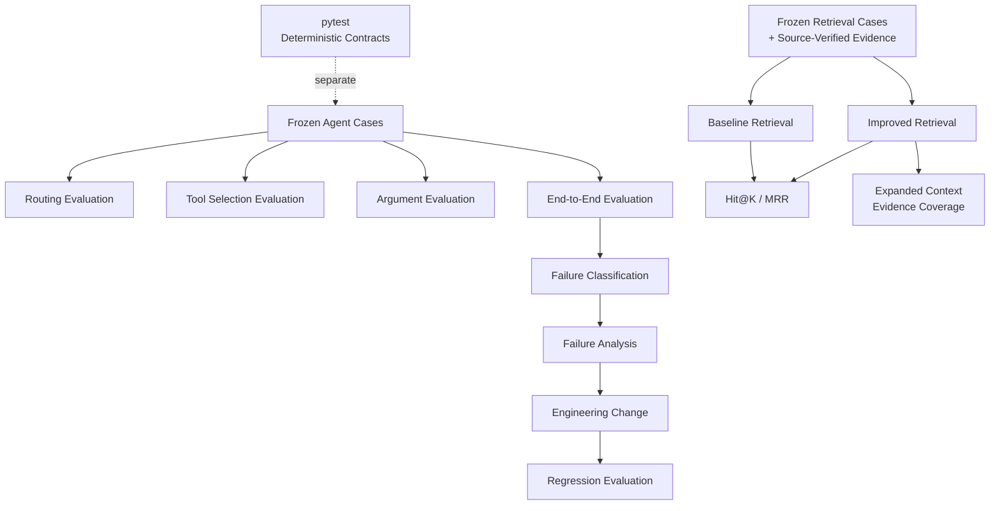
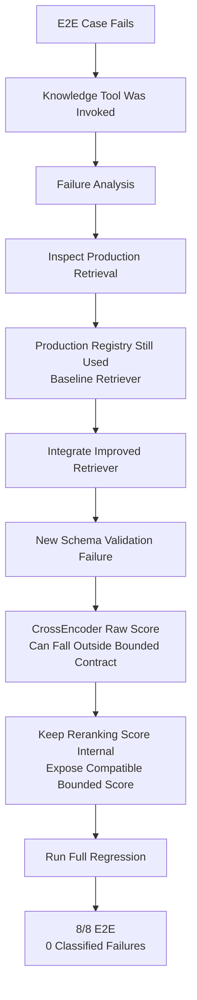

# Evaluation

## 1. Why Evaluation Is a First-Class Component

A successful demo answers:

> **Can the system work on this example?**

Evaluation asks a harder question:

> **Does the expected behavior hold across a fixed set of cases, and where does it fail?**

Agentic systems can fail at several independent stages:

```text
routing
tool selection
argument generation
tool execution
retrieval
context construction
termination
final answer generation
```

A plausible final answer can hide problems in any of those stages.

For that reason, Agentic Business Intelligence evaluates components separately and then evaluates the complete system end to end.

> **Scope:** all percentages in this document apply only to the stated frozen development/evaluation sets. They are not estimates of universal production accuracy.

---

# 2. Evaluation Architecture



The evaluation system therefore contains two broad categories:

```text
AI / retrieval evaluation
→ Does system behavior match expectations?

Software regression testing
→ Did deterministic software contracts break?
```

They are complementary, not interchangeable.

---

# 3. Evaluation Summary

## Agent behavior

| Evaluation | Frozen cases | Result |
|---|---:|---:|
| Skill routing | 15 | **15/15** |
| Tool selection | 15 | **15/15** |
| Structured argument extraction | 7 | **7/7** |
| End-to-end agent cases | 8 | **8/8** |
| Classified failures after final fixes | 8 E2E cases | **0** |

## Retrieval

| Metric | Baseline | Reranked |
|---|---:|---:|
| Hit@1 | 5/10 = **50%** | 6/10 = **60%** |
| Hit@3 | 7/10 = **70%** | 9/10 = **90%** |
| Hit@5 | 7/10 = **70%** | 9/10 = **90%** |
| MRR@5 | **0.600** | **0.750** |
| Expanded-context evidence coverage | — | **10/10 (100%)** |

## Deterministic software regression

```text
24 passed
```

These numbers measure different properties and should not be combined into a single "accuracy" score.

---

# 4. M13 — Agent Behavior Evaluation

A frozen development set was created to evaluate behavior across:

- structured-data questions;
- private-knowledge questions;
- boundary/ambiguous questions.

Three stages were measured separately.

| Evaluation | Result |
|---|---:|
| Skill routing | **15/15 (100%)** |
| Tool selection | **15/15 (100%)** |
| Structured argument extraction | **7/7 (100%)** |

These results describe the current frozen M13 set only.

---

# 5. Why Routing, Tools, and Arguments Are Separate

Consider this trajectory:

```text
Question
   ↓
Correct skill?
   ↓
Correct tool?
   ↓
Correct arguments?
   ↓
Tool execution
```

A correct route does not guarantee the correct tool.

A correct tool does not guarantee valid arguments.

And all three can be correct while the final answer still fails later.

Separating these dimensions makes failures easier to localize.

---

# 6. Router Improvement Example

One frozen case concerned Delta customer commitments during disruption.

The deterministic router initially selected the wrong path.

Rather than broadly rewriting the router, the failure led to a narrow change:

```text
add:
commitment
→ knowledge-oriented term

remove:
flight
→ overly generic data keyword

retain:
flight data
→ stronger structured-data phrase
```

After the targeted adjustment:

```text
Routing regression
15/15
```

The important point is not the perfect score on a small set.

The important point is the workflow:

```text
freeze cases
   ↓
measure
   ↓
observe failure
   ↓
make targeted change
   ↓
rerun same cases
```

---

# 7. M14 — Retrieval Evaluation

Retrieval was evaluated independently from answer generation.

This was necessary because an LLM can sometimes produce a plausible response even when the retrieved evidence is weak.

The final frozen M14 development set contains:

```text
10 source-verified retrieval cases
```

The evaluation focuses on **answer-bearing evidence**, not merely retrieving the correct document.

---

# 8. Baseline Retrieval

The baseline pipeline was:

```text
Question
   ↓
MiniLM embedding
   ↓
FAISS
   ↓
Top-K chunks
```

Embedding model:

```text
sentence-transformers/all-MiniLM-L6-v2
```

Strict baseline results:

| Metric | Result |
|---|---:|
| Hit@1 | **5/10 = 50%** |
| Hit@3 | **7/10 = 70%** |
| Hit@5 | **7/10 = 70%** |
| MRR@5 | **0.600** |

These results exposed an important distinction:

> Retrieving the correct document or semantic neighborhood is not necessarily the same as retrieving the exact answer-bearing chunk.

---

# 9. Improved Retrieval

The improved pipeline became:

```text
Question
   ↓
MiniLM embedding
   ↓
FAISS top 15 candidates
   ↓
CrossEncoder reranking
   ↓
Top 5 ranked evidence
   ↓
Neighbor expansion
   ↓
Final evidence context
```

Reranker:

```text
cross-encoder/ms-marco-MiniLM-L6-v2
```

Strict ranked results:

| Metric | Baseline | Reranked | Change |
|---|---:|---:|---:|
| Hit@1 | 50% | **60%** | +10 percentage points |
| Hit@3 | 70% | **90%** | +20 percentage points |
| Hit@5 | 70% | **90%** | +20 percentage points |
| MRR@5 | 0.600 | **0.750** | +0.150 |

On this frozen set, reranking improved the placement of answer-bearing evidence.

---

# 10. What Hit@K Means Here

For a retrieval question, Hit@K asks:

> Did at least one source-verified answer-bearing evidence chunk appear within the first K ranked results?

For example:

```text
Hit@1
→ evidence appears in the first ranked result

Hit@3
→ evidence appears somewhere in results 1–3

Hit@5
→ evidence appears somewhere in results 1–5
```

The project uses strict answer-bearing evidence rather than counting a merely related chunk as a hit.

---

# 11. MRR@5

Mean Reciprocal Rank rewards evidence appearing earlier in the ranked list.

For one query:

```text
rank 1 → reciprocal rank = 1.0
rank 2 → reciprocal rank = 0.5
rank 3 → reciprocal rank = 0.333...
```

If no relevant answer-bearing evidence appears in the first five results, that case contributes zero.

The project improved from:

```text
0.600
```

to:

```text
0.750
```

on the frozen M14 set.

This indicates that relevant evidence moved closer to the top of the ranked results on average.

---

# 12. Neighbor Context Expansion

Reranking improves ranking.

It does not solve every chunk-boundary problem.

Some evidence can be split across adjacent chunks.

The improved pipeline therefore performs neighbor expansion after ranking.

Conceptually:

```text
Ranked Chunk
     ↓
Is nearby context useful?
     ↓
Include adjacent chunk(s)
     ↓
Build final evidence context
```

Final expanded-context evidence coverage:

```text
10/10 = 100%
```

One case in the frozen set was explicitly identified as fragmented evidence.

---

# 13. Critical Metric Distinction

Expanded-context evidence coverage is **not Hit@K**.

The project keeps two concepts separate:

```text
reranked_results
→ actual ranked retrieval candidates
```

and:

```text
context_results
→ final evidence context after neighbor expansion
```

A neighboring chunk may help answer the question without having been independently retrieved at rank 1, 2, 3, etc.

The project therefore does **not** assign artificial ranks to expanded neighbors.

This prevents context construction from inflating ranked retrieval metrics.

---

# 14. What the Retrieval Results Actually Support

The measurements support this claim:

> On the frozen 10-case M14 development set, CrossEncoder reranking improved strict answer-bearing Hit@1, Hit@3, Hit@5, and MRR@5 compared with the measured FAISS baseline, while neighbor expansion provided answer-bearing context coverage for all 10 cases.

They do **not** support claims such as:

```text
"The RAG system is 100% accurate."

"The retriever will find every answer."

"The architecture is production-ready at arbitrary scale."
```

The 100% figure applies only to **expanded-context evidence coverage on the frozen 10-case set**.

---

# 15. M15 — End-to-End Agent Evaluation

The M15 set contains:

```text
8 frozen end-to-end cases
```

composed of:

```text
3 structured-data cases
5 private-knowledge cases
```

Each complete run is checked across multiple dimensions:

```text
skill
expected tool
arguments
stop reason
runtime errors
answer requirements
full-case pass
```

Final regression:

| Dimension | Result |
|---|---:|
| Skill | **8/8** |
| Tool | **8/8** |
| Arguments | **8/8** |
| Stop reason | **8/8** |
| Error-free run | **8/8** |
| Answer requirements | **8/8** |
| Full end-to-end pass | **8/8 (100%)** |

Again:

> **8/8 means 8/8 on the current frozen development set. It is not a general production accuracy estimate.**

---

# 16. Why End-to-End Evaluation Is Necessary

Component evaluation can show:

```text
router works
tool selection works
retrieval improves
```

but the user interacts with the complete system.

End-to-end evaluation therefore asks:

```text
Did the entire trajectory produce
the expected system outcome?
```

This caught a problem that individual tool checks did not.

---

# 17. M16 — Failure Analysis

Pass/fail alone is not sufficient for debugging an agent.

The project therefore introduced a deterministic failure taxonomy.

Current categories include:

```text
routing_failure
tool_selection_failure
argument_failure
tool_execution_failure
guard_triggered
termination_failure
answer_failure
```

Retrieval-specific evidence failures remain part of the M14 retrieval analysis rather than being collapsed into a generic agent failure.

After the final M16-driven fixes:

```text
0 classified failures
```

were recorded on the frozen 8-case M15 regression set.

---

# 18. Case Study — Fuel Expense Failure

The most important evaluation story in the project came from this question:

> According to Delta's 2025 10-K, what percentage of operating expense was fuel in 2025, 2024, and 2023?

The system initially failed.

But the failure was not where a superficial inspection might suggest.

The knowledge tool was being called successfully.

---

# 19. Failure Chain



This failure exposed two separate engineering problems.

---

# 20. Problem 1 — Experimental Improvement Was Not in Production

M14 had already produced an improved retriever.

However, the production tool registry was still connected to the baseline retrieval implementation.

This meant:

```text
evaluation experiment
≠
production execution path
```

The end-to-end test exposed that integration gap.

The production registry was updated to use the improved retriever.

---

# 21. Problem 2 — Interface Contract Failure

After integrating improved retrieval, another problem appeared.

CrossEncoder reranking produces a raw score useful for ranking.

That score should not automatically be treated as a normalized similarity value.

The existing external schema expected a bounded score.

The solution was to preserve the reranking value internally while exposing a compatible bounded FAISS score through the external contract.

This preserved:

```text
internal ranking semantics
```

without breaking:

```text
external tool schema
```

---

# 22. Recovered End-to-End Case

After the retrieval and interface fixes, the case recovered the required approximate values:

```text
2025: 17.1%
2024: 19.0%
2023: 21.1%
```

The full M15 regression then returned to:

```text
8/8
```

with:

```text
0 classified failure records
```

---

# 23. What the Failure Case Demonstrated

The case produced several engineering lessons:

1. Correct skill selection is not enough.
2. Correct tool selection is not enough.
3. Successful tool execution is not enough.
4. Experimental improvements must actually reach the production path.
5. Retrieval scores have semantics and should respect interface contracts.
6. Integration fixes can create new failures.
7. Regression evaluation is required after a fix.
8. Agent evaluation should inspect trajectories, not only final text.

This case is one of the strongest reasons evaluation is treated as part of the architecture rather than a final reporting step.

---

# 24. Software Regression Testing

AI evaluation is complemented by deterministic pytest regression tests.

Current suite status:

```text
24 passed
```

The suite covers deterministic contracts across the system.

Representative areas include:

| Area | Purpose |
|---|---|
| Skill routing | deterministic routing behavior |
| API schemas | request/response validation |
| API endpoints | health, validation, mocked agent flow |
| Frontend serving | HTML/CSS/JavaScript routes |
| Reliability | retry and error-classification behavior |
| Action guards | approval/read-write policy enforcement |
| Checkpointing | save/load/state restoration |
| Observability | trace/event persistence |

The exact test count per file may evolve as the suite grows; the current full regression contains **24 passing tests**.

---

# 25. Why pytest Is Separate From AI Evaluation

pytest answers deterministic questions such as:

```text
Does empty API input return 422?

Does the frontend route return HTML?

Are static CSS and JavaScript served?

Does a transient failure retry?

Does a permanent error avoid unnecessary retry?

Does an unapproved protected write remain blocked?

Can checkpoint state round-trip?

Can trace information be persisted?
```

Agent/retrieval evaluation asks different questions:

```text
Did the question route to the expected skill?

Did the model choose the expected tool?

Were the generated arguments correct?

Did retrieval return answer-bearing evidence?

Did the final answer contain the required information?
```

Combining these into one metric would obscure what failed.

---

# 26. Frontend Testing

M21 added a browser interface without changing the core agent.

The API regression suite now verifies that:

```text
GET /
→ serves the frontend

GET /static/styles.css
→ serves the stylesheet

GET /static/app.js
→ serves the JavaScript

JavaScript
→ contains the /ask API integration
```

The existing `/ask` test continues to mock `run_agent()`.

Therefore routine frontend/API regression does not require:

- OpenAI API calls;
- real RAG execution;
- real MCP execution.

This keeps the deterministic test suite inexpensive.

---

# 27. Reproducing the Evaluation

From the repository root:

```powershell
uv run python -m agentic_bi.evaluation.routing_eval
uv run python -m agentic_bi.evaluation.tool_selection_eval
uv run python -m agentic_bi.evaluation.argument_eval
uv run python -m agentic_bi.evaluation.retrieval_eval
uv run python -m agentic_bi.evaluation.agent_end_to_end_eval
```

Some model-backed evaluation paths may consume API credits.

Run deterministic software regression separately:

```powershell
uv run pytest
```

Current software regression:

```text
24 passed
```

---

# 28. Evaluation Principles

## Freeze before optimizing

Evaluation cases should remain fixed while comparing architectural changes.

Otherwise, improvement can be confused with changing the test.

---

## Evaluate trajectory, not only final text

The project separately inspects:

```text
routing
tool choice
arguments
execution
termination
answer requirements
```

A fluent answer alone is insufficient evidence.

---

## Evaluate retrieval independently

Generation should not hide poor retrieval.

Answer-bearing evidence is therefore measured directly.

---

## Keep ranked retrieval separate from context construction

Reranking and neighbor expansion solve different problems.

The metrics reflect that distinction.

---

## Do not inflate results

Expanded neighbor chunks are not assigned fake retrieval ranks.

Small frozen datasets are identified as small frozen datasets.

---

## Record failures

Failures are retained as engineering evidence.

The goal is to understand why the system failed and whether the fix survives regression.

---

## Test deterministic contracts deterministically

Routine software tests should not require model calls when the behavior being tested can be isolated.

---

# 29. Limitations

The current evaluation framework has important boundaries:

- M13, M14, and M15 use small frozen development sets.
- These sets are useful for regression and engineering comparison, not production confidence intervals.
- The current retrieval set contains only 10 source-verified cases.
- The end-to-end set contains only 8 cases.
- Some answer checks use required information/terms rather than comprehensive semantic grading.
- The domain is intentionally narrow.
- Model-backed evaluation can vary with model version and configuration.
- Expanded-context coverage measures evidence availability, not guaranteed answer correctness.
- The current evaluation does not provide broad adversarial or security benchmarking.
- The current measurements do not establish performance at production traffic or corpus scale.

---

# 30. Future Evaluation Work

Useful extensions include:

- larger held-out datasets separate from development cases;
- human relevance judgments from multiple annotators;
- citation correctness metrics;
- citation completeness metrics;
- groundedness and faithfulness evaluation;
- latency regression thresholds;
- token/cost regression thresholds;
- malformed-tool and adversarial-routing cases;
- controlled model stubs for deeper API integration tests;
- additional structured-data tools and corresponding evaluation cases;
- retrieval metadata-filter evaluation;
- evaluation under larger document collections.

These should be added when they help answer a concrete reliability question rather than merely increasing the number of metrics.

---

# 31. Final Perspective

The most important evaluation result from this project is not:

```text
100%
```

It is the development loop:

```text
Build
  ↓
Freeze Cases
  ↓
Measure
  ↓
Observe Failure
  ↓
Classify Failure
  ↓
Investigate the Trajectory
  ↓
Change the Architecture
  ↓
Run Regression
```

That loop turned evaluation from a reporting step into an engineering tool.

The project therefore treats evaluation not as proof that the system is universally correct, but as a disciplined way to make its behavior **measurable, debuggable, and progressively more reliable**.
---

# 32. Refactor Baseline (2026-10-02)

Recorded before the polish/refactor work. Every refactor phase is compared
against these numbers; a regression blocks the phase.

| Evaluation | Command | Result |
|---|---|---|
| pytest regression suite | `uv run python -m pytest` | 52/52 passed |
| Skill routing | `python -m agentic_bi.evaluation.routing_eval` | 15/15 (100%) |
| Tool selection | `python -m agentic_bi.evaluation.tool_selection_eval` | 15/15 (100%) |
| Tool arguments | `python -m agentic_bi.evaluation.argument_eval` | 7/7 (100%) |
| End-to-end (M15/M16) | `python -m agentic_bi.evaluation.agent_end_to_end_eval` | 8/8 (100%), 0 failure records |
| Baseline retrieval (strict) | `python -m agentic_bi.evaluation.retrieval_eval` | Hit@1 50%, Hit@3 80%, Hit@5 80%, MRR@5 0.650 |
| Reranked retrieval (strict) | `python -m agentic_bi.evaluation.improved_retrieval_eval` | Hit@1 60%, Hit@3 90%, Hit@5 90%, MRR@5 0.750 |
| Expanded-context coverage | (same) | 10/10 (100%) |

LLM-backed evaluations are non-deterministic; small run-to-run variation is
possible and should be re-run before being treated as a regression.
